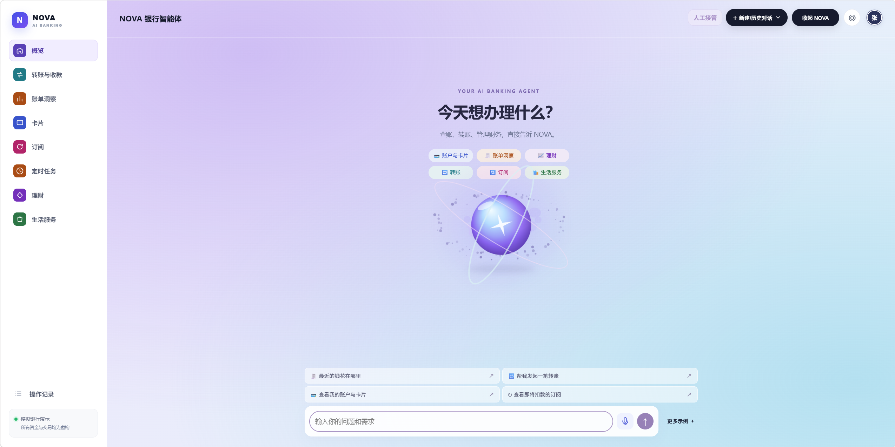

# NOVA · AI Banking Agent

通过自然语言查询银行资料、准备业务任务，并在本人确认和风险分级验证后办理模拟银行业务。项目面向银行AI智能体赛题，提供统一Web工作台。

> 全部账户资金、交易、商户与短信通道为比赛模拟。公开基金资料及净值有独立来源和日期；模拟执行成功不代表真实金融收益。完整AI体验需要配置可用的DeepSeek API。



登录后的NOVA首页：通过自然语言或快捷示例提出需求，也可从左侧进入业务工作台；涉及交易的操作仍须按风险等级完成本人确认和验证。

## 快速导航

- [部署说明：从准备环境到成功登录](docs/setup/deployment.md)
- [测试用例：逐步输入、点击与预期结果](docs/testing/test_cases.md)
- [开发者自动化测试与证据索引](docs/testing/automated_tests.md)
- [技术文档：系统架构图、核心算法与安全设计](技术文档.md)
- [安全自评报告：权限分级与已知风险](安全自评报告.md)
- [第三方声明：组件来源、许可与数据使用边界](THIRD_PARTY_NOTICES.md)

从[部署说明](docs/setup/deployment.md)启动项目，再按[测试用例](docs/testing/test_cases.md)体验各场景。实现原理和安全评估分别见技术文档与安全自评报告。

## 项目解决的问题

把分散的银行入口变成“表达需求—查看任务—本人核对—执行—核对结果”的统一流程。用户既可以让NOVA理解模糊表达、补充上下文和规划多目标任务，也可以在工作台手动办理；人工接管保留已有输入和操作编号。模型负责理解和规划，银行服务核验身份、金额、资格、版本及授权，办理结果可通过业务状态、流水和操作记录核对。

## 场景与当前能力

| 赛题场景 | 当前可体验的能力 | 使用说明 |
|---|---|---|
| 智能转账 | 按联系人／手机号准备转账，多轮修改，单次定时转账，AA收款及原结果核对 | 转账须本人确认，达到红色条件须MFA；定时转账按指定时点单次执行 |
| 账单分析 | 月度／年度统计、分类和变化追溯、异常核对、预算与订阅关联查询 | 新库默认无历史流水；没有数据时如实显示，需先生成模拟流水再体验变化 |
| 理财操作 | 本人风险评估、整体规划、类别／名称／代码候选、详情与比较、申购、赎回、持仓和整体收益 | 候选不等于购买；有效评估、产品资格、金额、本人确认与MFA仍需核验 |
| 卡片管理 | 查询、虚拟卡申请、限额／渠道调整、锁卡、解锁、挂失及补卡任务 | 高风险操作须验证；挂失与临时锁卡不同，不能用解锁恢复已挂失卡 |
| 订阅／代扣 | 已有订阅及预计月费查询、扣费关联核对、本人确认取消、模拟扣费和测试恢复 | 查询及管理模拟银行已有订阅，核对扣费与预计月费 |
| 跨场景联动 | 多目标任务图及按依赖推进；账单＋订阅、日程＋订阅查询；日程、资金锁定任务、模拟花店／蛋糕店与银行付款 | 按当前能力目录规划任务；商户下单及付款仍经本人核对和授权 |

另支持语音转文字、历史会话、业务上下文、操作审计、中断与人工接管。通过浏览器Web应用使用。详细步骤和可观察判据见 [测试用例](docs/testing/test_cases.md)。

## 主要实现特点

- **受控办理**：自然语言准备任务与可信界面授权分离，查询、本人确认、强验证的边界可见。
- **可干预的规划**：多目标呈现依赖及状态；本人可修改草稿、暂停后续步骤或接管，已完成交易不因对话取消而回滚。
- **事实可核对**：回复使用工具结果；总资产与可支付现金分开，未核实结果不当作成功，也不因超时就断言未执行。
- **配置可解释**：理财规划参考理查德·塞勒的心理账户理论及Das、马科维茨等人的整体协调研究，运用凸优化及持仓约束投影，将个人事实和偏好转成三板块配置；目标产品推荐不调用整体配置模型。

理财模型将资金用途、风险承受能力、现有资产和投资偏好转为可核对、可调整的活钱／稳健／进取配置。研究依据见[理财知识说明](backend/app/knowledge/wealth_planning.md)，算法与验证范围见[技术文档](技术文档.md)。

## 安全设计原则与参考

针对模型可能误解需求、生成无依据结果或被诱导越权的问题，项目采用服务端权限分级、任务事实核验、本人确认与MFA、关键操作审计、安全锁定及人工接管等措施。模型输出不能替代执行凭证，外部资料和聊天文本不能自行赋予业务权限。

设计参考国家金融监督管理总局2026年6月18日发布的 [《关于银行业保险业人工智能安全开发应用的指导意见》](https://www.nfra.gov.cn/cn/view/pages/ItemDetail.html?docId=1261784&generaltype=1&itemId=4216)（金发〔2026〕8号）所关注的安全治理方向。具体机制、权限分级和已知风险见[技术文档](技术文档.md)与[安全自评报告](安全自评报告.md)。

## 安装与启动

1. 安装并启动Docker，确认 `docker --version` 和 `docker compose version` 可运行。
2. 解压完整源码，在根目录复制 `.env.example` 为 `.env`，填写自己的DeepSeek API Key。不要覆盖已有配置或提交真实密钥。
3. Windows运行 `start_bank.cmd`；Linux／macOS运行 `bash scripts/start_bank.sh`。默认启动包含SenseVoice语音服务，首次构建及模型下载需要网络。
4. 启动器报告成功后访问 [http://localhost:3000/](http://localhost:3000/)，登录并按 [测试用例](docs/testing/test_cases.md) 体验。

详细的逐平台命令、成功判据、演示账号、数据前提、更新停止和排障见 [部署说明](docs/setup/deployment.md)。健康检查通过不等于DeepSeek认证成功。仅重启旧容器不会加载后来修改的源码。

## 数据与体验边界

固定资料包随源码提供，包含806只真实基金（债券242、混合501、权益63）及19个模拟银行产品定义；购买资格、有效净值、交易窗口及额度按产品逐项核验。项目使用模拟适当性评级，当前目录涵盖普通债券、混合和权益基金及模拟银行产品。资料升级见 [固定资料与旧库保护](docs/setup/wealth_compact_upgrade.md)。

新申赎使用最近已公布有效NAV，经本人确认和MFA后模拟即时记账；持有期、窗口、额度与资格仍适用，成功后不可撤。收益按整体产品口径展示。语音只转写，不自动发送或授权，首次下载未就绪不影响文字输入。

## 仓库结构

```text
README.md                    项目入口和体验导航
backend/                     API、Agent、银行服务与安全实现
frontend/                    Web工作台与可信操作卡片
security/                    共用权限定义
config/、data/                产品配置与随源码固定资料
scripts/                     启动、安装和开发工具
tests/                       后端与浏览器测试代码
frontend/tests/              前端逻辑与组件测试
docs/setup/deployment.md      面向评委的部署步骤
docs/testing/test_cases.md    测试用例（手工操作步骤与预期结果）
docs/testing/automated_tests.md  开发者自动测试及证据索引
技术文档.md                  架构图、核心算法和安全设计
安全自评报告.md              权限分级实现及已知风险清单
```

仓库保留技术文档和安全自评报告的Markdown原稿，便于随源码维护和导出。历史研究与验收资料按各自标注的日期、版本和环境查阅。

## 测试

评委先按 [测试用例](docs/testing/test_cases.md) 观察输入、任务、授权与结果；开发者按 [自动化测试说明](docs/testing/automated_tests.md) 运行既有用例。测试索引列明各项使用的模型、数据库、环境及验证范围。

## 主要技术与第三方组件

下表按当前入口、源码引用及构建配置列出主要组件；完整依赖及版本以清单和锁文件为准。

| 组件／服务 | 本项目用途 | 官方来源 |
|---|---|---|
| React＋TypeScript | 登录页、NOVA对话、业务工作台与操作卡片交互 | [React](https://github.com/facebook/react)、[TypeScript](https://github.com/microsoft/TypeScript) |
| Vite | 前端开发服务及生产资源构建 | [官方项目](https://github.com/vitejs/vite) |
| FastAPI＋Pydantic | 后端业务／Agent接口、请求与结构化模型输出校验 | [FastAPI](https://github.com/fastapi/fastapi)、[Pydantic](https://github.com/pydantic/pydantic) |
| PostgreSQL＋SQLAlchemy | 持久化账户、模拟交易、任务、会话和审计，提供异步数据库访问 | [PostgreSQL](https://www.postgresql.org/)、[SQLAlchemy](https://github.com/sqlalchemy/sqlalchemy) |
| ECharts | 账单分类与趋势图、产品净值曲线 | [官方项目](https://github.com/apache/echarts) |
| react-markdown＋remark-gfm | 渲染NOVA回答中的Markdown、表格和列表 | [react-markdown](https://github.com/remarkjs/react-markdown)、[remark-gfm](https://github.com/remarkjs/remark-gfm) |
| Docker Compose＋Nginx | 编排前后端、数据库及语音服务，提供前端静态资源与同源接口代理 | [Compose](https://github.com/docker/compose)、[Nginx](https://nginx.org/) |
| SenseVoice／SenseVoiceSmall | 本地CPU语音转文字 | [SenseVoice](https://github.com/QwenAudio/SenseVoice)、[SenseVoiceSmall模型](https://huggingface.co/FunAudioLLM/SenseVoiceSmall/tree/3847d57b6bdf2dd8875cb1508d2af43d80a16bf7) |
| AKShare | 可选市场数据获取适配及资料准备 | [官方项目](https://github.com/akfamily/akshare) |
| DeepSeek API | 自然语言理解、任务规划及知识解释 | [DeepSeek](https://www.deepseek.com/) |

其他依赖以依赖清单和锁文件为准，组件来源、许可及数据边界集中见 [第三方声明](THIRD_PARTY_NOTICES.md)；语音部署见 [语音说明](docs/setup/voice_input.md)。真实API密钥、私人研究原件及本地业务数据库不随源代码包提供。代码、模型及数据分别适用其来源对应的许可与使用条件。
