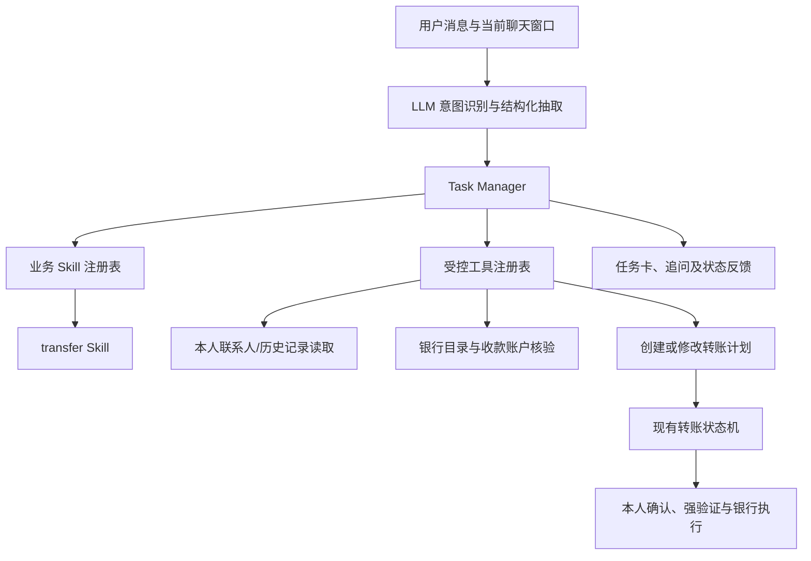

# 转账 Agent 与聊天任务管理规划

> 状态：2026-10-20 已按首期范围实现；接口和实际边界见 [NOVA 转账任务接口](../contracts/NOVA转账任务_API_v0.1.md)。范围：在统一 NOVA 聊天窗口发起即时人民币转账；复用现有转账任务状态机与模拟银行执行链路。

当前入口顺序：所有模型模式消息统一进入 NOVA 原生工具循环，由模型根据本轮目标自主决定查询工具、调用顺序及是否调用 `manage_transfer_request`；不再先经过确定性意图路由器，单轮最多执行10次工具调用。一句话可依次调用多个只读工具和转账草稿工具。服务端向模型提供当前焦点任务的结构化摘要，使“修改备注”等后续请求能定位现有草稿，但摘要不是授权。转账工具读取服务端保存的原始消息，再加载转账 Skill 抽取明示字段；模型查询得到的历史金额必须同时提交来源流水 ID，付款账户必须提交账户 ID，服务端分别重新核验本人已完成转出金额及账户归属，不能把模型自由文本直接当成银行事实。转账工具成功后立即返回任务结果，避免模型重复调用直到步数耗尽。对于“可用余额的一半”，Skill 调用本人银行 API 取得付款账户及可用余额；多账户先让用户选卡，再计算具体金额。收款人或号码不明确时保留聊天草稿并询问。字段与账户核验完成后才创建待本人确认的银行转账计划；任务卡确认及必要验证完成后才可能扣款。离线模式不做规则式意图规划，复杂请求需启用模型。

首期实现采用 `nova_task_sessions.state` 保存同一窗口的任务数组，配合消息回执和脱敏消息表；没有单独建立 `chat_tasks` 表。当前 Skill 注册表只加载转账 Skill，新增业务时再扩展注册与任务类型。下文的 `chat_sessions/chat_tasks` 是可继续演进的逻辑模型，不代表现有物理表名。

## 1. 目标与现状

用户可以在 NOVA 里说“给张三转 200 元”，Agent 识别转账意图、建立一笔待处理任务、查找本人可用的收款人资料、追问缺失信息，并在资料齐全后生成可核对的转账计划。一次话语可以包含多笔转账，后续消息可以分别补充或修改其中一笔。

现有代码已有两块能力，但尚未接成这一体验：

- `services/ai/nova.py` 是统一聊天入口，已有联系人和历史转账人的只读工具；当前没有转账写工具。聊天历史主要由前端内存传回，刷新后不构成可靠任务记录。
- `services/ai/conversation.py` 支持即时转账信息抽取、追问、候选选择和生成待确认计划，但一个转账会话仅绑定一个 `task_id`。`services/orchestration`、`/api/v1/tasks/*` 已提供转账计划、确认、验证、受理、查询等状态机能力。
- 本人联系人和历史转账人已有查询、解析接口；银行目录和银行卡/手机号查询负责核验实际收款账户。联系人资料是查找线索，不是直接扣款依据。

因此新增的是**统一聊天的任务编排层**，并复用现有银行与授权服务；不另建一套扣款状态机。

## 2. Agent 结构

| 部件 | 职责 | 权限边界 |
|---|---|---|
| LLM 理解层 | 判定查询/转账/补充/修改/取消等意图；从本轮消息及当前上下文提取明确给出的收款人、金额、付款账户、备注等；拆分多笔请求 | 输出候选结构，不直接决定账户 ID、授权或成功状态；字段要保留原文证据 |
| Task Manager | 按登录用户和聊天窗口保存任务列表、草稿槽位、焦点任务、版本、消息与工具回执；路由后续补充与修改；恢复页面时重建任务卡 | 只有它能调用受控的计划创建/修改工具；操作幂等且校验任务归属 |
| Skill 注册表 | 根据已确认的业务意图加载对应业务流程说明和字段契约；转账意图加载 `transfer` Skill，其他业务按各自 Skill 扩展 | Skill 是服务端版本化的业务规则，不从用户消息、备注或网页内容加载指令 |
| 工具注册表 | 暴露带严格参数 Schema 的只读查询和受控写入能力；服务端注入本人身份并记录调用结果 | 模型传入的用户 ID、账户归属、风险判断一律不采信 |
| 业务状态机 | 生成计划版本、风险与确认卡；处理本人确认、第二因素验证、受理、执行、对账和终态 | 现有 `services/orchestration` 与银行服务是资金状态的唯一权威 |

“Agent 自主拉起任务”指自主创建**草稿或待确认计划**。扣款必须经过现有确认和按风险等级要求的验证；自然语言“确认”“执行”不能代替可信任务卡上的本人操作。

## 3. Task Manager 与任务数量

### 3.1 数据模型

建议新增持久化的 `chat_sessions`、`chat_messages`、`chat_tasks`（或等价模型）：

- `chat_sessions`：`session_id`、`user_id`、`version`、当前焦点任务、创建/更新时间。一个登录用户可有多个窗口会话。
- `chat_messages`：消息 ID、角色、时间、原始内容引用及处理结果；保存请求回执以支持网络重试。敏感字段按现有数据保护要求处理，不在日志中输出完整卡号/手机号。
- `chat_tasks`：`chat_task_id`、`session_id`、`user_id`、`type=transfer`、`status`、`slots`、`missing_fields`、`candidate_set`、`skill_version`、可空的现有 `transfer_task_id`、`state_version`、`plan_version`。草稿与银行侧正式任务分开；缺信息时不调用银行创建正式任务。

聊天任务状态建议为 `COLLECTING`（收集资料）、`NEEDS_SELECTION`（候选消歧）、`READY_FOR_REVIEW`（已生成计划）、`AWAITING_CONFIRMATION`、`AWAITING_VERIFICATION`、`IN_PROGRESS`、`SUCCEEDED`、`FAILED`、`CANCELLED`；后六种由现有转账状态机快照映射，不自行推断。每笔转账拥有独立 ID、金额、收款人和确认卡。

### 3.2 拆分与指代

- 一个明确的“收款人 + 金额”组合建立一笔任务。“给张三转 100，给李四转 200”建立两笔；“给张三和李四各转 100”拆成两笔并分别核对。
- “给张三转 100 和 200”或“转 300 给他们”无法唯一拆分时先追问，不猜任务数或分摊金额。
- 新消息明确说“再给王五转 50”就新增任务；“把给张三的金额改为 150”按收款人和任务 ID 定位修改。存在两笔张三任务时要求用户选择任务卡。
- 无法确定“这笔”“他”所指时使用当前焦点任务；若同一窗口有多个合理目标，返回带任务编号的选择列表，不把补充信息写到任意一笔。
- 同一请求 ID 重试不得创建第二笔；多笔请求要有稳定的子任务序号或派生幂等键。并发消息通过会话版本控制，旧版本返回冲突并要求刷新。
- 任务数量由结构化意图和确定性校验共同决定。LLM 提议的拆分结果须能逐项对应原文；不明示的收款人、金额或笔数不得补造。

## 4. `transfer` Skill 设计

建议把 Skill 定义为仓库内版本化文档与机器可读字段契约，例如 `backend/app/skills/transfer/SKILL.md` 和同目录 Schema。Skill 说明对话策略；服务端代码执行校验，避免只靠提示词约束。其他业务可用同样目录组织自己的 Skill。

Skill 的顺序：**识别转账意图 → 提取本轮明确字段 → 合并到指定任务 → 查询本人可用线索 → 判断收款人类型 → 核验候选 → 计算缺失字段 → 生成待确认计划 → 跟踪现有状态机结果**。每轮只询问真正缺失或有歧义的字段，已有且仍有效的信息不重复索取。

### 4.1 字段槽位

每笔转账保存：

| 字段 | 是否必需 | 来源与规则 |
|---|---|---|
| 收款人线索 `recipient_ref` | 必需 | 用户明示的姓名、备注名、已存联系人、历史收款人或完整手机号/银行卡号；记录原文及来源 |
| 已核验收款账户 `to_account` | 必需 | 只能来自银行目录/收款人解析工具；多候选须由用户选择，不由模型猜测 |
| 金额 `amount_fen` | 必需 | 从原文提取后由确定性金额解析器换算为整数分；拒绝无效、零负值、超过精度或上限的金额 |
| 付款账户 `from_account` | 必需 | 用户指定时按本人账户解析；未指定时仅使用银行认可的唯一/默认付款账户，多账户无默认则追问 |
| 备注 `note` | 可选 | 用户明示备注优先；可沿用现有有限自动备注规则，显示在确认卡中 |
| 转账方式/时间 | 首期固定为即时人民币 | 定时、周期、AA、外币等走已有业务入口或后续独立 Skill；不误建即时转账任务 |

槽位要保存 `value`、`source`（用户明示/联系人/历史/银行查询）、`evidence_message_id`、`verified_at` 和有效性。已修改收款人时清空旧候选及 `to_account`；改付款账户时清空 `from_account`；改金额或备注后重新生成计划版本，旧确认与验证证据失效。

### 4.2 已转过账或已保存的收款人

先用本人联系人/历史转账人只读查询匹配姓名或备注名，再调用现有联系人解析或银行目录重新核验当前收款账户。**历史记录只用于减少用户输入，不保证账户仍有效，也不自动暴露或补全用户从未提供过的完整号码。**

匹配唯一且账户仍有效时，用户通常只需提供“收款人称呼 + 金额”；付款账户可按银行默认规则确定。若同名、多个账户、历史资料失效或用户说“转到另一张卡”，展示脱敏候选并追问。确认卡仍显示真实银行返回的收款人姓名、脱敏账户、金额、付款账户和备注。

### 4.3 从未转过账的新收款人

要求**收款人姓名 + 完整手机号或完整银行卡号 + 金额**；若用户同时给出手机号和银行卡号，两者必须对应同一收款人。对银行卡号路径，按现有收款人/银行卡核验接口解析；不能仅凭姓名在全行目录中猜一位同名用户，也不能凭手机号后四位或掩码查询。付款账户按同一默认/追问规则确定。

例：用户说“给王五转 300 元”，未匹配本人联系人或历史收款人时，回复“请提供王五的完整手机号或银行卡号”，不创建可执行转账计划；用户补充号码后再核验姓名与号码的一致性。若查无收款账户、姓名不符、账户停用或候选不唯一，给出明确原因并继续等待更正或选择。

现有 `transfer_directory` 对姓名能搜索银行用户，旧转账对话也可能据唯一姓名生成计划；新 Skill 对**新收款人**要收紧为“姓名 + 完整号码”后才能调用计划创建。手机号与卡号的可见性继续遵循联系人已有的 `phone_known`/`card_known` 边界。

### 4.4 缺失信息反馈

先区分“缺字段”和“有歧义”：缺收款人问收款人；新收款人缺号码问手机号或银行卡号；缺金额问金额；付款账户无默认或有多个候选时展示脱敏选项。同一轮可合并询问，例如“这两笔还缺：任务 1 金额；任务 2 收款人完整手机号或银行卡号”。任务卡同时显示已获取信息及下一步，避免用户不知道哪笔在等待。

## 5. 工具与接口接线

首期工具建议分三组，均由服务端校验参数与登录身份：

1. **只读**：`search_my_transfer_recipients`（保存联系人与历史转账人）、`resolve_recipient`（联系人/完整手机号/完整卡号及银行目录核验）、`list_my_payer_accounts`、`get_transfer_task`。只返回必要且脱敏的候选；候选 ID 绑定用户、聊天任务、查询版本及短有效期，选择时重新核验。
2. **受控计划写入**：`create_transfer_plan`、`modify_transfer_plan`、`cancel_transfer_draft`。前两者仅在槽位完整、候选确定后调用现有 `create_transfer_task`/`modify_task`；提交请求带稳定 `request_id`、`operation_id`、版本与参数摘要。取消草稿只影响未提交银行的聊天草稿；正式任务取消走现有状态机接口。
3. **可信本人操作**：现有任务卡确认、验证、受理和取消接口。确认卡内容来自状态机快照；前端通过明确点击和必要的 TOTP/短信流程提交。Agent 不能调用验证签发或代替用户确认。

建议扩展 `/api/v1/nova/chat` 与 `/chat/stream` 的响应，包含 `session_id`、`session_version`、`task_updates[]` 和 `focus_task_id`；增加本人会话任务列表/恢复接口。流式回答可先发送文字，但创建/修改后的任务卡以最终 `done` 与服务端任务查询为准。现有 `/api/v1/tasks/*` 继续作为银行任务的权威接口；NOVA 的任务索引只引用它，不复制资金状态。前端 NOVA 面板显示多张独立任务卡，并支持选择焦点任务、补充字段及刷新状态。

## 6. 一轮处理流程

1. 服务端读取登录身份、会话版本和本窗口任务摘要；LLM 输出严格 JSON：意图、涉及的任务引用、每笔字段及原文证据。服务端校验字段确实出现于本轮消息或已保存的可信任务上下文。
2. Task Manager 根据任务拆分规则创建草稿或定位旧任务；加载 `transfer` Skill，合并槽位并执行只读查找。无法定位的修改先追问任务编号。
3. 确定性校验金额、收款方式、候选和付款账户；将 `missing_fields` 写回草稿。信息不完整时返回追问和任务卡，不创建银行任务。
4. 信息完整时调用银行侧核验并创建/修改现有转账计划，保存 `transfer_task_id` 与快照版本，显示待本人核对的确认卡。
5. 本人按卡片确认并完成所需验证后由现有状态机受理、执行及对账。Task Manager 查询权威快照更新任务卡；超时或 `UNKNOWN` 时显示处理中/待核对，不声称成功，也不另建操作重试。

## 7. 实施顺序与验收

1. 定义转账 Skill、结构化抽取 Schema、缺失字段规则及“历史/新收款人”判别；复用现有 NLU 的原文校验与金额解析。
2. 增加聊天会话与多任务持久化、版本/幂等回执；把现有单任务转账对话逻辑抽成可由 Task Manager 调用的转账处理器，保留旧接口兼容。
3. 接入本人联系人/历史、手机号/银行卡、付款账户和银行目录工具；落实新收款人姓名加完整号码的约束及候选消歧。
4. 将计划创建/修改接到现有状态机，扩展 NOVA 响应与多任务卡；刷新后可恢复任务，确认/验证仍走可信卡片。
5. 验证单笔缺字段追问、多笔拆分与分别补全、同名候选、已转账与新收款人、修改后旧授权失效、重复请求、并发版本冲突、号码与姓名不符、任务跨用户隔离、超时/未知状态以及未经确认不扣款。

首期完成标准：在统一 NOVA 窗口能从自然语言建立一笔或多笔独立的即时转账草稿；只在每笔信息齐全且银行核验成功后生成待确认计划；所有实际转账沿用现有确认、验证和执行链路，任务卡可在会话恢复后继续查看。
