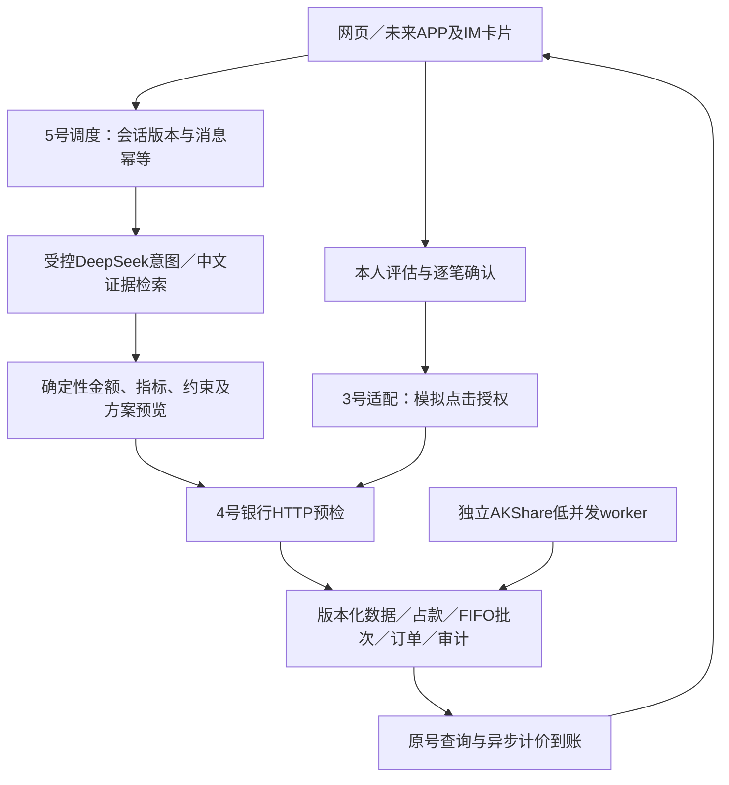

# 比赛材料草稿：理财场景 v1.2

## 作品简介（200字以内）

银行AI Agent将自然语言需求转成可核对的模拟业务任务。理财场景结合全量基金目录、真实基金及官方规则模拟理财、知识引用与确定性分析，追问预算、备用金和期限，生成可修改方案。本人评估、披露确认及高风险点击模拟授权后，由模拟银行完成申赎、占款和异步结算，支持原号恢复和审计。真实数据与模拟交易分别标识，不连接真实银行。

## 架构与算法

金融数字由Decimal及整数分计算；统一窗口收益/回撤/波动/相关性、A/C家族集中度与日历约束。模型仅理解和引用解释，禁止签发授权、代答评估或调管理员。seed固定共同因子，数据版本/业务时钟/可用时间防未来泄漏。独立资金上下文不复制余额。

## 安全设计与自评依据

| 评审维度 | 实现与证据 | 边界／未完成 |
|---|---|---|
| 任务完成40% | 自然语言追问、配置/修改、本人评估、模拟申赎、原号查询；真实模型联调及双库回归 | 理财只算一个场景；全项目三场景及跨场景最终验收需团队核对 |
| 安全30% | JWT主体、适当性、逐笔参数摘要、授权期限、审计事务、并发占款、幂等；注入与跨用户测试 | 点击是模拟替身，未实现真实支付密码/MFA；不声称赛事豁免 |
| 创新与体验30% | 对话＋可信卡片、来源可追溯、共同窗口图表、家族合并、解释失败不假造事实 | 不是微调/预训练；不提供保证收益和真实投顾服务 |

## 要求—实现—证据—差距

| 要求 | 当前实现 | 证据 | 未完成项 |
|---|---|---|---|
| 推荐、评估、申赎及资金调整 | 受控意图＋原有批量方案/银行闭环 | wealth_live_model、wealth_bank/research测试 | 真实银行接入不在范围 |
| 风险分级、本人确认、强验证 | R1–R5适当性＋可信卡片＋SIMULATED_CLICK | auth/并发/过期/改参回归 | 真实强验证未实现 |
| 数据、知识、宏观 | 目标44真实基金＋16官方规则模拟理财、全量目录、50篇当前语料、8指标 | fixed manifest、真实AKShare同步、100题评测 | PE/PB及语义embedding条件增强未启用 |
| APP/IM发起/追问/查询/结果 | 可复用messages及卡片契约、授权回跳网页 | contract.md渠道示例 | 独立APP/IM联调和渠道验收未完成 |
| 来源与原创 | 原创生成器/界面/规则、官方定义摘要 | data_sources、knowledge、THIRD_PARTY_NOTICES | 团队最终版权及官方提交口径审核 |

## 5分钟视频时间分配

0:00–0:25项目与模拟边界；0:25–1:15转账；1:15–1:55账单；1:55–3:55理财预算→追问→对比→改金额→本人确认→模拟授权→状态；3:55–4:30异常/原号恢复；4:30–5:00架构、数据来源、限制。时钟推进可事先准备固定场景，不把剪辑后的结算称真实即时交易。

## 10分钟答辩分配

1分钟目标与三场景范围；3分钟理财连贯演示；2分钟算法/数据版本；2分钟安全与幂等；1分钟测试；1分钟限制与成员交接。留团队问答节奏，不擅自宣称视频豁免；以最终官方要求核对视频必交/可选差异。

来源：仓库赛题说明、团队工作记忆及用户v1.2任务书；技术来源和开源许可见THIRD_PARTY_NOTICES。实际运行证据见docs/validation/wealth_v1_2_20261002.md。本文为可纳入最终材料的草稿，非团队签字或评委评分。

## 最新数据方案与评审边界

首批目标不是系统上限。当前44份额覆盖货币6、债券12、宽基10、行业6、主动10；16虚构银行理财覆盖现金、日开、最短持有、周期开放、封闭期。基金真实数据不等于真实交易资格；缺审核风险/完整规则仅研究。模拟理财基于单份说明书，未知值与模拟调整独立记录，不承诺目前真实在售。原60合成份额和18场景用于离线回归。实际数量、联网失败、最新测试及清理结果以补充验证摘要为准；旧证据不冒充新数据方案验收。
