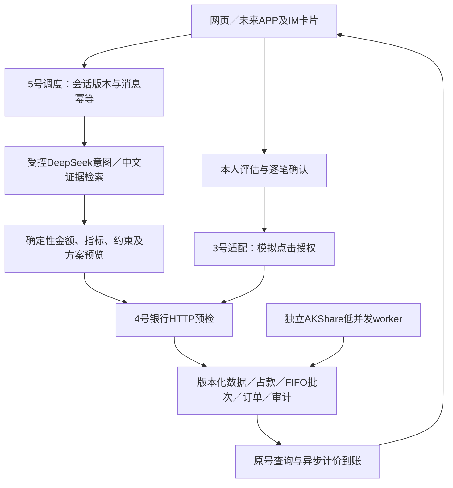

# 比赛材料草稿：理财场景 v1.2

## 作品简介（200字以内）

银行AI Agent将自然语言需求转成可核对的模拟业务任务。理财结合真实基金研究、规则模拟理财及确定性分析，从上下文理解投入意愿、目标、期限和流动性，按歧义澄清并保存需求与任务图，展示可修改配置及行情指标。本人评估、披露确认和点击模拟授权后，模拟银行完成申赎、占款、异步结算与原号查询。真实研究数据、模拟价格及交易分别标识，不连接真实银行。

## 2026-10-03语义与展示增量

- DeepSeek输出严格结构化补丁，保留引用、来源和版本；支持未知、拒绝提供、否定、更正和复合需求。“我有”不直接视为投入，具体支出用途与额外保留现金不强制填写。目标、期限及到账要求参与约束，不把“保值”写成保本保证。
- 理财子DAG实际持久化，先研究后配置与先赎回到账后配置使用真实依赖；到账比例按原号实际到账核对。总Agent和跨场景总DAG由2号负责。默认推荐仍为现有规则，通过provider接口可替换，并独立校验输出。
- 横向配置图以本次预算为分母；账户余款单列。详情提供1月/3月/1年净值、区间变化、最大回撤和年化波动率，缺失或样本不足不补零。78个模拟条目固定价格（60基金份额、18银行理财），不等同78个独立风险来源；A/C及模板关联保留。
- 中国2021–2026历史交易日历与2027预测日历分开标注；18时发布和业务时点屏蔽未来价格。预测日历须在官方发布后换版，不宣称已核验2027休市安排。
- 验收使用[本轮24项矩阵](../validation/wealth_semantic_dag_20261003.md)，区分真实DeepSeek、typed夹具、双库及浏览器证据，不以旧E01–E40数字代替新版本验证。

## 架构与算法

金融数字由Decimal及整数分计算；统一窗口收益/回撤/波动/相关性、A/C家族集中度与日历约束。模型仅理解和引用解释，禁止签发授权、代答评估或调管理员。seed固定共同因子，数据版本/业务时钟/可用时间防未来泄漏。独立资金上下文不复制余额。

## 安全设计与自评依据

| 评审维度 | 实现与证据 | 边界／未完成 |
|---|---|---|
| 任务完成40% | 自然语言追问、配置/修改、本人评估、模拟申赎、原号查询；真实模型联调及双库回归 | 理财只算一个场景；全项目三场景及跨场景最终验收需团队核对 |
| 安全30% | JWT主体、适当性、逐笔参数摘要、授权期限、审计事务、并发占款、幂等；注入与跨用户测试 | 点击是模拟替身，未实现真实支付密码/MFA；不声称赛事豁免 |
| 创新与体验30% | 对话＋可信卡片、来源可追溯、共同窗口图表、家族合并、解释失败不假造事实 | 不是微调/预训练；不提供保证收益和真实投顾服务 |

## 要求—实现—证据—差距

| 要求 | 当前实现 | 证据 | 未完成项 |
|---|---|---|---|
| 推荐、评估、申赎及资金调整 | 受控意图＋原有批量方案/银行闭环 | wealth_live_model、wealth_bank/research测试 | 真实银行接入不在范围 |
| 风险分级、本人确认、强验证 | R1–R5适当性＋可信卡片＋SIMULATED_CLICK | auth/并发/过期/改参回归 | 真实强验证未实现 |
| 数据、知识、宏观 | 当前44真实基金＋18官方规则模拟理财、全量目录、版本化知识语料、8指标 | fixed manifest、真实AKShare同步、混合池测试；100题仅为离线契约回归 | PE/PB及语义embedding条件增强未启用；本轮完整验收仍进行中 |
| APP/IM发起/追问/查询/结果 | 可复用messages及卡片契约、授权回跳网页 | contract.md渠道示例 | 独立APP/IM联调和渠道验收未完成 |
| 来源与原创 | 原创生成器/界面/规则、官方定义摘要 | data_sources、knowledge、THIRD_PARTY_NOTICES | 团队最终版权及官方提交口径审核 |

## 5分钟视频时间分配

0:00–0:25项目与模拟边界；0:25–1:15转账；1:15–1:55账单；1:55–3:55理财预算→追问→对比→改金额→本人确认→模拟授权→状态；3:55–4:30异常/原号恢复；4:30–5:00架构、数据来源、限制。时钟推进可事先准备固定场景，不把剪辑后的结算称真实即时交易。

## 10分钟答辩分配

1分钟目标与三场景范围；3分钟理财连贯演示；2分钟算法/数据版本；2分钟安全与幂等；1分钟测试；1分钟限制与成员交接。留团队问答节奏，不擅自宣称视频豁免；以最终官方要求核对视频必交/可选差异。

来源：仓库赛题说明、团队工作记忆及用户v1.2任务书；技术来源和开源许可见THIRD_PARTY_NOTICES。当前实际运行证据见docs/validation/wealth_v1_2_supplement_20261002.md；前阶段证据见wealth_v1_2_20261002.md。本文为可纳入最终材料的草稿，非团队签字或评委评分。

## 最新数据方案与评审边界

首批目标不是系统上限。当前44份额覆盖货币6、债券12、宽基10、行业6、主动10；18虚构银行理财覆盖现金、日开、最短持有、周期开放、封闭期，含新增B017/B018两只模拟现金管理产品。基金真实数据不等于真实交易资格；缺审核风险/完整规则仅研究。模拟理财保留单一规则模板与来源，未知值与模拟调整独立记录，不承诺目前真实在售。原60合成份额和18场景用于离线回归。实际数量、联网失败、最新测试及清理结果以验证摘要为准；旧证据不冒充新方案验收。

## 2026-10-03增量演示能力（按用户修订范围验收）

对话工作台支持持久化任务图、暂停恢复、本人确认与原号恢复、操作员唯一领取及交还。普通撤单依合同窗口处理；B017/B018模拟快赎在服务窗口内同一事务减少份额、增加现金、生成唯一流水，成功后不可撤，按北京时间自然日共享产品额度。测试轮次可归档重置、调整当前模拟资金及预览确认后物理删除旧归档；普通账户不进入这些工具。

这些是虚构账本与模拟授权能力，不能称真实银行即时兑付或真实强验证。历史流水修复先在备份副本追溯审计，不猜测价格或重写余额；普通账户未能证明历史计价时保留账务并限制新增写入。桌面实际模型申购与手机快赎已核对，快赎100份到账105.55元、唯一流水/结算各1，重启恢复一致。专用断网模块按用户比赛范围移除，未声称完成实际断网验收；截图落盘受阻。最终视频按[本轮验收表](../validation/dialogue_ledger_20261002.md)的实际证据演示，跳过项不计通过。
