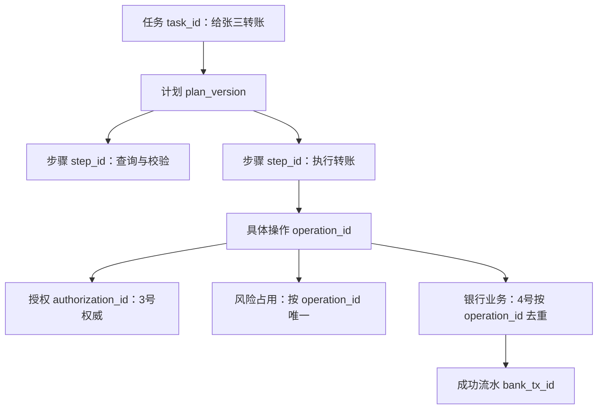
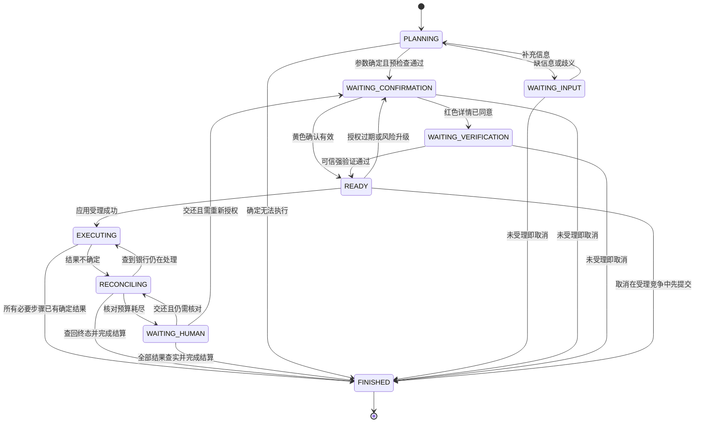
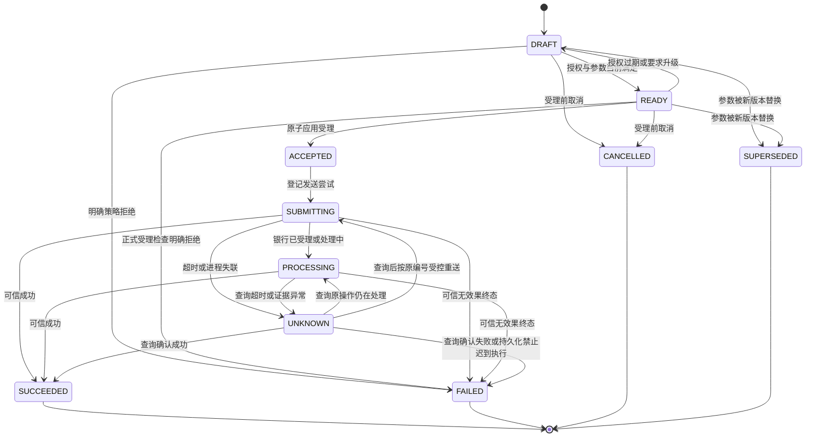
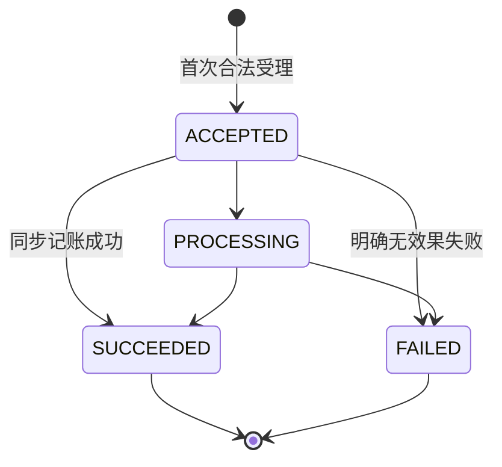
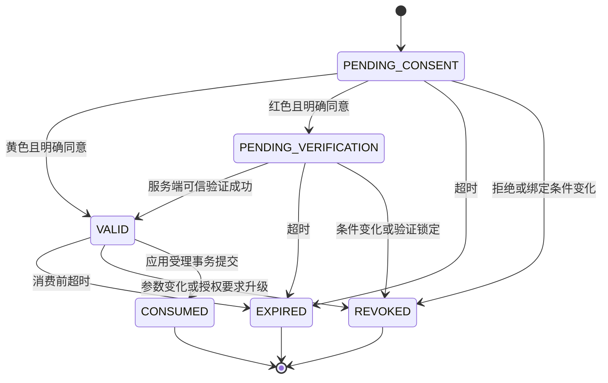
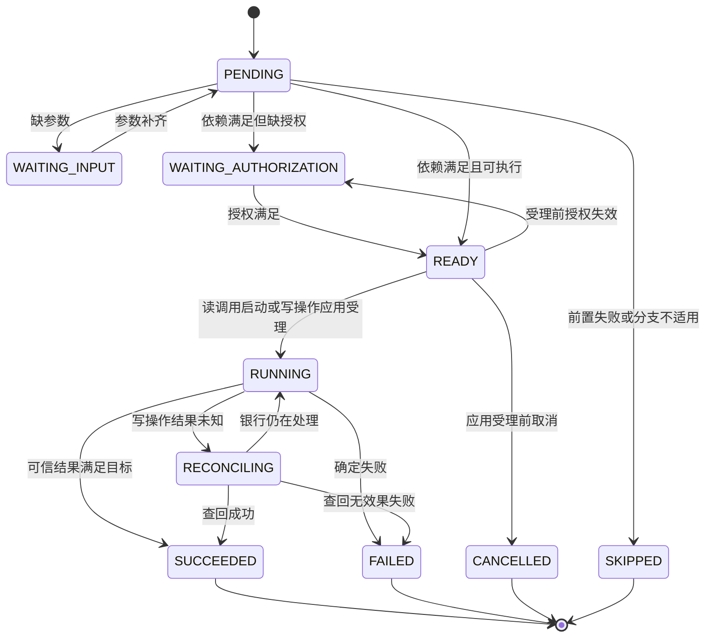
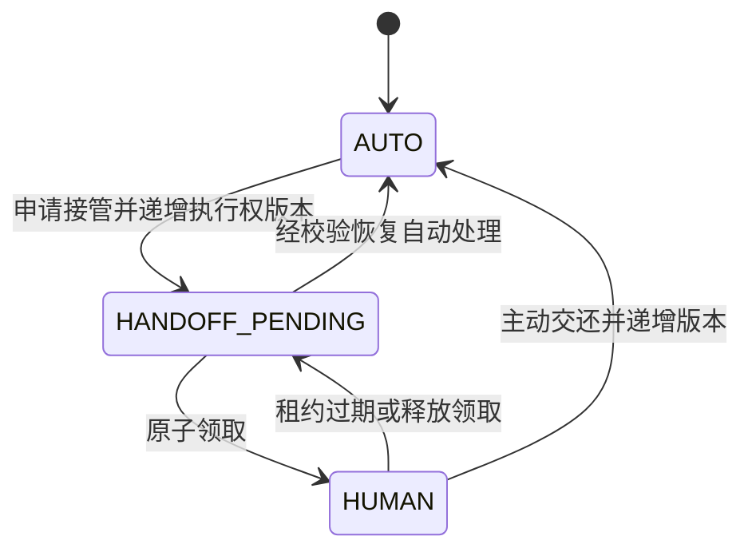

# 5号工作：任务执行与联调状态机设计建议

版本：v0.2 ｜ 日期：2026-09-19 ｜ 状态：银行数据访问边界已落地，其余状态机细节继续评审。

本文面向负责**任务执行与联调的5号成员**，以人民币即时转账为首个落地场景，覆盖正常执行、参数修改、授权过期、重复提交、响应丢失、取消、重启恢复和人工接管。

依据：[团队分工与接口对齐工作记忆](智能转账_团队分工与接口对齐_工作记忆_v0.1_20260916.md)，特别是第6—8节。本文将其中的状态语义展开为可评审的枚举与转移规则；新增命名及细节均为建议，不代表其他成员已同意。

## 0. v0.2 已冻结的数据访问边界

本轮将以下规则定为实现约束，而不是口头约定：

1. 4号模拟银行是账户、用户目录、余额、累计转账额、银行操作和流水的唯一数据访问者。
2. 5号不得导入 `AccountORM`、`UserORM`、`TransactionORM`、`BankOperationORM`，也不得把自己的数据库会话传给银行实现函数。
3. 5号只通过 `BankApi` 调用4号的内部 HTTP API，获得账户校验、收款人解析、幂等提交和按 `operation_id` 查询结果。
4. 5号可直接持久化自己负责的任务、计划、步骤、操作观察副本、授权引用、风险占用、outbox、事件和人工工单；这些属于应用状态，不是银行账本。
5. 当前 MVP 可以共用一个 PostgreSQL 实例，但应用状态表与银行账本表之间不建立跨边界 ORM 访问或数据库外键。以后拆库时，5号代码不应需要改业务逻辑。
6. 确认卡所需的收款人名称在计划创建时以银行 API 返回值固化；任务查询不得为了展示再次直读银行表。

当前对应代码入口：

- 5号端口：`backend/app/integrations/bank_api.py`
- 4号内部 API：`backend/app/routers/bank_operations.py`
- 4号数据库实现：`backend/app/services/bank/transfer_service.py`
- 自动边界检查：`tests/unit/test_bank_boundary.py`

## A. 推荐状态分层

### A.1 总体建议：五层状态，三个独立控制字段

不要用一个 `status` 同时表示“用户待确认”“银行处理中”“任务结束”。推荐分为以下五层：

| 层次 | 回答的问题 | 建议字段 | 权威维护者 |
|---|---|---|---|
| 任务层 | 用户这件事进行到哪一步，最后完成得怎样？ | `task.phase`、`task.outcome` | 5号；根据下层事实计算 |
| 步骤层 | 计划中的某个节点能否调度，是否完成？ | `step.status` | 5号 |
| 操作观察层 | 对这一笔具体转账，执行器目前知道什么？ | `operation.status` | 5号；依据可靠证据推进 |
| 银行业务层 | 银行是否受理，实际是否记账成功？ | `bank_operation.status` | 4号；5号只保存观察副本 |
| 授权层 | 用户是否同意，强验证是否满足，凭据是否可用？ | `authorization.status` | 3号；5号通过受控接口使用 |

此外独立维护：

| 控制字段 | 用途 | 维护边界 |
|---|---|---|
| `task.control_mode` | 自动执行、等待人工领取或人工执行 | 5号；搭配执行权版本 |
| `task.cancel_requested` | 记录用户已要求停止后续执行 | 5号；本阶段只允许 `false → true` |
| `risk_reservation.status` | 记录本操作的风险占用及结算 | 3号定义规则；5号协调事务 |

这些字段相互关联，但不互相替代。例如，人工接管不会把“结果未知”改成“失败”；用户取消也不会把已成功转账改成“已撤回”。首版仍可采用模块化单体和同一数据库实例，但必须遵守第0节的 API 与数据所有权边界。

### A.2 五个对象如何关联



- 一个任务有一个当前计划版本，历史版本保留；一个计划包含多个步骤，首版只有一笔转账写操作。
- 一个写步骤可以因**受理前修改参数**产生多个历史操作，但最多有一个当前可受理操作；旧操作必须先失效。查询步骤不必创建转账操作。
- `operation_id` 在提交前创建，提交、查询、核对、恢复都使用它；`bank_tx_id` 是成功后取得的凭证，不能代替前者。
- 请求编号 `request_id` 只标识一次交互。不同请求可以指向同一操作；同样金额、同样收款人也可能属于两个经用户分别授权的新操作。
- `plan_version` 管计划变更，`state_version` 管并发更新，`control_epoch` 管执行权，三者不能混用。

### A.3 必须区分两次“受理”

1. **应用受理**：5号协调3号，在一个事务内完成操作登记、授权消费、风险占用、待执行记录。此时操作为 `ACCEPTED`，银行可能尚未收到请求。
2. **银行受理**：4号持久化收到的操作，银行状态成为 `ACCEPTED` 或直接进入可信终态。

本文建议：应用受理后，参数即不可修改；首版取消只阻止尚未应用受理的写操作。已应用受理操作继续按原编号执行或核对。这使取消与发送之间的竞争有明确边界。若以后支持撤销已排队操作，必须增加能原子阻止发送的协议，不能只改状态。

## B. 每层状态枚举

以下使用大写值表达契约语义；最终序列化形式由团队统一。所有状态变更必须经领域方法，不能开放“任意设置状态”的业务接口。

### B.1 任务阶段 `TaskPhase`

| 枚举 | 含义 | 前端建议展示 |
|---|---|---|
| `PLANNING` | 正在理解、校验或形成计划 | 正在整理转账信息 |
| `WAITING_INPUT` | 必要参数缺失或存在歧义 | 请补充信息／选择收款人 |
| `WAITING_CONFIRMATION` | 等待对本版本具体详情明确同意 | 请核对并确认 |
| `WAITING_VERIFICATION` | 已同意详情，等待可信强验证 | 请完成身份验证 |
| `READY` | 条件表面满足，等待正式受理时再次检查 | 准备提交 |
| `EXECUTING` | 有已受理、正在发送或银行处理中的操作 | 正在处理 |
| `RECONCILING` | 至少一笔操作结果未知，正在核对 | 结果待核对，请勿重复转账 |
| `WAITING_HUMAN` | 需要人工领取或正在人工处理 | 等待人工处理／人工处理中 |
| `FINISHED` | 所有必要步骤已结算，无未知或在途写操作 | 根据 `outcome` 展示结果 |

`TaskOutcome` 单独保存：

| 枚举 | 判定含义 |
|---|---|
| `NONE` | 尚未终结，不能给出最终结论 |
| `SUCCEEDED` | 当前有效业务目标全部完成，并有可信证据 |
| `FAILED` | 目标未完成，无成功业务写操作，存在明确执行失败、策略拒绝或不可恢复的规划错误 |
| `CANCELLED` | 用户请求取消，所有业务写操作均未产生效果，且没有未解决的明确失败 |
| `PARTIAL` | 多笔业务中已有部分成功，其他目标因失败或取消未完成；预留给多步骤扩展 |

聚合按当前有效业务目标及所有已受理历史操作计算，查询成功不算“部分转账成功”，受理前被替换的旧草稿也不算业务失败。建议顺序：未全部结算则 `NONE`；目标全部完成则 `SUCCEEDED`；部分业务成功则 `PARTIAL`；无业务成功但有明确失败则 `FAILED`；剩余用户主动取消情形为 `CANCELLED`。拒绝确认按取消处理；政策阻断按失败处理并给出原因。

单笔转账成功后才收到取消请求，最终仍是 `SUCCEEDED`，同时反馈“转账已完成，无法通过取消任务撤回”。

### B.2 步骤状态 `StepStatus`

| 枚举 | 含义 |
|---|---|
| `PENDING` | 等待前置依赖满足 |
| `WAITING_INPUT` | 本步骤缺少必要业务参数 |
| `WAITING_AUTHORIZATION` | 等待确认或强验证；具体要求见授权层 |
| `READY` | 依赖和参数满足，可进入调度检查 |
| `RUNNING` | 查询正在执行，或写操作已应用受理且尚无终态 |
| `RECONCILING` | 对应写操作为 `UNKNOWN`，必须核对 |
| `SUCCEEDED` | 已取得该步骤要求的可信结果 |
| `FAILED` | 确定失败；写操作必须有不会再扣款的依据 |
| `CANCELLED` | 在应用受理前被用户取消 |
| `SKIPPED` | 因上游失败、分支不适用或旧计划被替换而不再执行 |

后四项为本步骤实例的终态。终态不重开；重新规划生成新步骤实例并保留关联。默认只有前置步骤 `SUCCEEDED` 才满足依赖；失败后依赖节点转 `SKIPPED`，不能因为前置有返回字典就继续执行。可选分支若允许跳过，需要在计划中明确。

### B.3 操作观察状态 `OperationStatus`

| 枚举 | 含义 | 是否允许首次提交到银行 |
|---|---|---|
| `DRAFT` | 参数已形成，仍待授权或检查 | 否 |
| `READY` | 授权当前可用，等待应用受理事务 | 否 |
| `ACCEPTED` | 应用受理事务已提交，待执行记录已持久化 | 是，必须通过受控调度 |
| `SUBMITTING` | 已登记发送尝试，请求可能已到银行 | 禁止开启新业务；原编号恢复见D节 |
| `PROCESSING` | 银行可信响应表明已受理或处理中 | 否，查询原操作 |
| `UNKNOWN` | 无法确认银行当前结果 | 否，先核对原操作 |
| `SUCCEEDED` | 银行证据确认成功 | 否 |
| `FAILED` | 有可信证据确认未产生效果且以后不会执行，或受理前已明确拒绝 | 否 |
| `CANCELLED` | 应用受理前被取消，发送路径已关闭 | 否 |
| `SUPERSEDED` | 应用受理前被新参数版本替换 | 否 |

最后四项为终态。网络超时、HTTP 5xx、连接断开、查询暂未找到，均不足以证明 `FAILED`。`SUBMITTING` 必须在网络调用前持久化；该阶段即使尚未真正发出请求，重启后也保守进入核对。

### B.4 银行业务状态 `BankOperationStatus`

| 枚举 | 4号必须提供的语义 |
|---|---|
| `ACCEPTED` | 银行已持久化受理该操作，可能尚未完成记账 |
| `PROCESSING` | 正在处理，结果未定 |
| `SUCCEEDED` | 记账提交成功，能返回关联业务凭证 |
| `FAILED` | 明确失败且无转账效果；同编号后续请求不能再次执行 |

`SUCCEEDED`、`FAILED` 为不可互转的终态。模拟银行若同步完成事务，可以不暴露中间态。

`NOT_FOUND` 是**查询响应类别**，不是银行业务终态，也不是操作失败证明。银行响应还应区分“查询服务不可用”和“已查到业务记录”。若要据“未受理”终结，银行必须能提供持久化封禁该编号、拒绝所有迟到请求的保证；首版没有此能力时保持 `UNKNOWN`，交人工核对。

### B.5 授权状态 `AuthorizationStatus`

| 枚举 | 含义 |
|---|---|
| `PENDING_CONSENT` | 等待用户同意展示过的具体操作详情 |
| `PENDING_VERIFICATION` | 已取得同意，但还需要可信强验证 |
| `VALID` | 本凭据在有效期及绑定条件内可用于应用受理 |
| `CONSUMED` | 已在应用受理事务中消费，不能授权另一笔业务 |
| `EXPIRED` | 消费前已超时 |
| `REVOKED` | 消费前因参数变更、风险升级、用户拒绝或安全策略而失效 |

`CONSUMED`、`EXPIRED`、`REVOKED` 均为本凭据终态。重新确认创建新凭据，不能把旧凭据改回 `VALID`。验证尝试失败可保持 `PENDING_VERIFICATION` 并递增次数；达到3号配置的上限则撤销凭据并进入安全锁定或人工处理。

授权至少绑定可信用户、`operation_id`、`plan_version`、付款账户、唯一收款目标、整数分金额、币种、参数摘要、已满足的验证强度、有效期和授权要求版本。摘要必须覆盖所有影响实际业务或用户同意的字段。

黄色：同意详情后可 `VALID`；红色：同意详情后先 `PENDING_VERIFICATION`，只有3号验证成功才可 `VALID`。风险颜色不是授权状态。

### B.6 独立控制状态

| 字段 | 枚举 | 说明 |
|---|---|---|
| `ControlMode` | `AUTO`、`HANDOFF_PENDING`、`HUMAN` | 自动、冻结新写操作并待领取、人工持有执行权 |
| `RiskReservationStatus` | `HELD`、`SETTLED`、`RELEASED` | 占用中、转成功累计、确定无效果后释放；受理前没有占用记录 |

人工控制搭配 `owner_id`、`control_epoch`、`lease_expires_at`。领取、交还、超时回收均原子更新版本；租约过期后先回到 `HANDOFF_PENDING`，经显式恢复才回到 `AUTO`。

`cancel_requested`、`error_code`、`reason_code`、`next_retry_at`、`attempt_count` 是控制或解释信息，不应扩成几十种主状态。账号安全锁定由3号判定，5号记录阻断原因并停止新受理，不中断对已受理操作的核对。

## C. 状态转移图

图展示主路径；转移的必要前提及原子边界以D、E节为准。

### C.1 任务主路径



补充规则：任何未终结阶段都可因接管进入 `WAITING_HUMAN`；受理前修改关键参数返回 `PLANNING`；人工交还后根据真实子状态重新计算阶段，可能回到任一非终态。取消时只要仍有在途操作，就保留 `EXECUTING`／`RECONCILING`／`WAITING_HUMAN`，并展示“已停止后续步骤，原转账仍在处理”。

### C.2 操作观察状态



`UNKNOWN → SUBMITTING` 只允许重送已受理的原操作，不能重新消费授权、重复风险占用或产生新编号。前提是4号保证同编号同参数幂等、终态拒绝再执行，且5号验证原受理记录和当前执行权；不具备该契约时继续核对或交人工。

### C.3 银行业务与授权





### C.4 步骤与执行权



其他受理前状态也可取消、因计划替换而跳过或因明确拒绝而失败；已受理写步骤不得沿这些边跳过核对。



接管只转移继续执行的权限，不能撤销已经发出的银行请求。冻结自动新写操作后，已发请求的结果仍可通过统一事实归并入口落库；查询和核对可以继续，查询得到事实不等于获得发起新业务的权限。

## D. 关键状态转移表

### D.1 统一处理约定

每次转换接收事件和服务端可信上下文，验证当前状态、`state_version`、计划版本、执行权及事件去重键。状态变化和对应持久化事件在同一事务提交；相同事件重放返回已有结果，过期事件不覆盖新状态。

建议持久化：任务、计划版本、步骤、操作、授权引用、风险占用、待执行记录（outbox）、人工工单和状态事件。网络调用在事务外执行，不持锁等待模型、用户或银行响应。

### D.2 关键转换

| 编号／触发 | 原状态 → 目标状态 | 必要检查与持久化动作 | 失败、重复或竞争时的处理 | 协作方 |
|---|---|---|---|---|
| T01 用户提出转账 | 新任务 → `PLANNING`；缺信息 → `WAITING_INPUT` | 服务端取用户身份；登记请求、任务、计划版本；校验模型候选参数 | 不完整或同名不猜测，返回明确待办 | 2、5号 |
| T02 参数确定 | 任务 → `WAITING_CONFIRMATION`；操作 → `DRAFT`；授权 → `PENDING_CONSENT` | 校验账户归属、唯一收款目标、整数分金额及计划依赖；生成绑定版本的详情卡片；风险预检查 | 策略明确拒绝则确定失败；预检查不可用则暂停，不能放行；草稿不占风险额度 | 1、2、3、5号 |
| T03 用户确认 | 黄色授权 → `VALID`；红色 → `PENDING_VERIFICATION` | 校验用户、卡片、操作、参数摘要及版本；保存明确同意证据 | 旧卡片、跨用户或模糊确认拒绝；多笔待确认时要求明确选择 | 1、3、5号 |
| T04 强验证返回 | `PENDING_VERIFICATION → VALID`；任务／操作 → `READY` | 3号服务端核验挑战、用户及操作绑定；保存验证结果引用与有效期 | 不接受模型或请求正文自报通过；失败计数达到配置上限进入锁定处理 | 1、3、5号 |
| T05 受理前改金额／收款目标等 | 旧操作 → `SUPERSEDED`；旧未消费授权 → `REVOKED`；任务 → `PLANNING` | 与受理竞争使用同一版本保护；保存新计划、新操作编号，旧待办失效；无变化的重复请求不增版本 | 若受理已先提交，拒绝修改原操作；新业务意图另建任务，继续核对原操作 | 1、2、3、5号 |
| T06 正式应用受理 | 操作 `READY → ACCEPTED`；授权 `VALID → CONSUMED`；风险新建 `HELD`；步骤 → `RUNNING` | 同一事务核验最新身份、所有权、取消标记、授权有效期和最新风险；原子保存操作受理、消费、占用、outbox | 任一条件失败全部回滚；并发只允许一次成功。提交结果不明时查原操作，不创建新操作 | 3、5号 |
| T07 受理时风险升级／授权过期 | 操作 `READY → DRAFT`；任务 → `WAITING_CONFIRMATION` | 旧凭据撤销或记为过期；新建满足最新要求的授权流程 | 不消费旧授权、不新增占用、不发送业务；红色重新同意详情并强验证 | 1、3、5号 |
| T08 发送银行请求 | `ACCEPTED → SUBMITTING` | 领取outbox时校验执行权；先持久化发送尝试，再携原操作编号、原参数和可信执行上下文调用4号 | 发送结果未知走T10；发送线程崩溃不生成新编号 | 4、5号 |
| T09 银行给出结果 | `SUBMITTING/PROCESSING/UNKNOWN → PROCESSING/SUCCEEDED/FAILED` | 核验来源、操作和参数匹配；归并银行证据；终态处理与本地风险结算、步骤推进、事件落库原子提交 | 银行已成功但本地落库失败则重查恢复；迟到的处理中响应不得覆盖成功；冲突终态进入异常核查 | 3、4、5号 |
| T10 超时／响应丢失 | `SUBMITTING/PROCESSING → UNKNOWN`；步骤 → `RECONCILING` | 保留操作、受理事实及 `HELD`；登记核对任务、重试时间和原因 | 不宣告失败，不释放占用，不自动创建替代转账 | 4、5号 |
| T11 查询原操作 | `UNKNOWN → PROCESSING/SUCCEEDED/FAILED`，或仍 `UNKNOWN` | 按原 `operation_id` 查询；找到终态则走T09；暂未找到则继续核对或按C.2条件重送原操作 | 超时／未找到都不能直接失败；重送不再次授权、不再次占用 | 4、5号 |
| T12 核对预算耗尽 | 任务 → `WAITING_HUMAN`；控制 → `HANDOFF_PENDING` | 原子冻结自动新写操作并生成／复用工单；操作保留 `UNKNOWN`，占用保留 `HELD` | 时间或次数阈值只是升级条件，不是失败证据 | 1、5号 |
| T13 用户取消 | `cancel_requested: false → true`；受理前操作 → `CANCELLED` | 与受理、修改使用相同并发保护；撤销未消费授权；停止未受理步骤；已受理操作继续处理 | 若受理先成功，取消只阻止后续操作；不能把在途或成功操作改成取消 | 1、3、5号 |
| T14 人工领取／交还 | 控制按C.4转换 | 校验操作员权限；原子设置领取人、租约并递增 `control_epoch`；每次写入口重新校验 | 过期执行者不能再发新写操作；已发出的同编号银行请求仍可完成；人工不能代替用户授权 | 1、3、5号 |
| T15 进程重启／页面刷新 | 根据持久化事实恢复，不创建新的业务意图 | `ACCEPTED` 恢复待发送；遗留 `SUBMITTING` 转核对；`PROCESSING/UNKNOWN` 查询原操作；终态不重放 | 刷新只读快照；旧worker依靠版本和执行权失效；事件断线靠完整快照补齐 | 1、4、5号 |
| T16 任务收尾 | 任务 → `FINISHED`；计算最终 `outcome` | 所有必要步骤结算、无可执行待办、无在途或未知写操作；风险占用已结算／释放；保存结果摘要与凭证 | 不满足条件则保持原阶段；人工点“结单”不能跳过这些条件 | 1、3、5号 |

应用受理后的同编号重送是在完成已经授权的业务。原授权的自然到期不撤销已经提交的受理事实，也不允许复用它发起新业务。若银行明确失败，用户重试属于新操作，需要新的授权流程。

### D.3 任务阶段的计算优先级

首版建议一次只推进一个用户授权待办，避免多个卡片争抢任务主阶段。每次下层状态变化后，在服务端统一计算：

1. 全部满足T16：`FINISHED`，计算 `outcome`。
2. 控制模式为 `HANDOFF_PENDING/HUMAN`：`WAITING_HUMAN`，同时返回真实操作状态。
3. 存在 `UNKNOWN`：`RECONCILING`。
4. 存在 `ACCEPTED/SUBMITTING/PROCESSING`：`EXECUTING`。
5. 否则按当前待办：`WAITING_INPUT`、`WAITING_CONFIRMATION`、`WAITING_VERIFICATION`、`READY` 或 `PLANNING`。

`phase` 是展示投影，不能用它单独决定可否扣款。返回 `allowed_actions` 时必须同时检查操作、授权、控制模式、取消标记和用户权限；服务端在实际执行动作时再次检查。

### D.4 贯穿联调样例：扣款成功，但响应丢失

| 时刻 | 任务阶段 | 操作观察状态 | 银行事实 | 授权 | 风险占用 |
|---|---|---|---|---|---|
| 用户确认300元后 | `READY` | `READY` | 无记录 | `VALID` | 无记录 |
| 应用受理提交后 | `EXECUTING` | `ACCEPTED` | 无记录 | `CONSUMED` | `HELD` |
| 请求到银行 | `EXECUTING` | `SUBMITTING` | `PROCESSING` | `CONSUMED` | `HELD` |
| 银行记账，响应丢失 | `RECONCILING` | `UNKNOWN` | `SUCCEEDED` | `CONSUMED` | `HELD` |
| 按原编号查回并落库 | `FINISHED / SUCCEEDED` | `SUCCEEDED` | `SUCCEEDED` | `CONSUMED` | `SETTLED` |

第四行是合法且必须支持的状态组合。银行事实和执行器观察短暂不一致是网络故障的正常结果；通过查询收敛，不能为了“统一状态”将银行或任务直接改成失败。

## E. 必须保证的不变量（invariants）

以下应成为5号与3、4号的接口验收条件。状态名称可以调整，这些语义不能丢失。

| 编号 | 不变量 | 实现／验收要求 |
|---|---|---|
| I01 身份可信 | 用户身份与操作员权限来自服务端可信上下文 | 前端传入其他用户编号、模型声称有权限，均不能改变归属检查 |
| I02 参数确定 | 可受理操作绑定唯一付款账户、唯一收款目标、币种和正整数分金额 | 同名收款人必须消歧；拒绝超过两位小数的金额，不静默舍入；金额不以浮点数作为账务真值 |
| I03 授权绑定 | 应用受理必须有覆盖本用户、本操作、本参数版本与最新风险要求的授权 | 改金额、换目标、旧卡片、跨用户确认、验证过期均不能绕过检查；红色必须有详情同意和可信强验证 |
| I04 原子受理 | `ACCEPTED` 意味着授权消费、风险占用、待执行记录均已持久化 | 要么全部成功，要么全部回滚；任何银行写请求都必须能追溯到已提交的受理事实 |
| I05 操作幂等 | 同一个业务操作最多产生一次资金效果 | 相同编号相同参数重放同一结果；相同编号不同参数拒绝；请求重试、重启、超时不换操作编号 |
| I06 参数不可变 | 应用受理后的操作参数和所属授权事实不可改写 | 修改受理前草稿必须使旧版本失效；受理后另建业务意图，原操作继续核对 |
| I07 成功有证据 | 写步骤或操作成功必须有银行可信成功记录 | HTTP 200、模型文案、工具“调用结束”、人工备注均不能独立构成成功证据 |
| I08 未知不等于失败 | 超时、未找到、预算耗尽均不得直接推出未执行 | `UNKNOWN` 保留风险占用；不存在 `UNKNOWN → FAILED` 的纯计时转换 |
| I09 终态单调 | 银行与操作终态不会被迟到事件降级或重开 | 成功后收到“处理中”不回退；冲突终态保存异常证据并核查；退款需独立业务，不能改写原成功事实 |
| I10 风险一致 | 每个已受理未终结操作恰有一份有效风险占用 | 成功仅结算一次；明确无效果仅释放一次；未知不释放；同编号重送不重复计入 |
| I11 并发风险复核 | 正式受理使用同用户所有付款账户的最新累计风险 | 按用户串行化风险核验与占用登记，不能各自读旧值后同时放行；余额检查另由4号保证 |
| I12 账务原子 | 银行业务去重、余额检查、余额变更、对应流水在同一事务内提交 | 并发不超支、不部分记账；内部转账的借贷记录一致，外部模拟收款需有明确记账模型 |
| I13 取消不伪造撤回 | 取消只能终止本方案中尚未应用受理的操作 | 已受理继续处理；已成功不变取消；取消与受理并发时有唯一提交顺序 |
| I14 执行权互斥 | 同一时刻只有当前执行权持有者可发起新的写动作 | 原子领取、版本校验、租约回收；旧worker不能在人工接管后新受理或领取发送任务；已发请求按原编号收敛 |
| I15 结束意味着结算完成 | `FINISHED` 不包含未知、在途操作或悬挂占用 | `FINISHED ⇔ outcome != NONE`；存在 `UNKNOWN` 或 `HELD` 时不能结单；结束不等于全部成功 |
| I16 恢复依赖持久化事实 | 聊天记录、进程内存与前端页面不是业务状态真值 | 重启从数据库和银行记录恢复；刷新不再触发转账；已成功步骤不重放 |
| I17 依赖真实完成 | 后继步骤只能在契约要求的前置结果满足后开始 | 不能只检查前置“返回了数据”；上游失败、未知均阻断依赖写步骤 |
| I18 全链路可追溯 | 每次关键变更可定位到事件、身份、操作、版本及证据 | 记录请求／任务／步骤／操作／授权引用、前后状态、原因、时间及执行者；日志不保存原始验证码或完整认证秘密 |
| I19 银行数据单一入口 | 5号不直接读取或写入银行数据表 | 账户校验、收款人解析、提交、核对均经4号 API；静态边界测试必须通过 |

### E.1 风险累计的建议精确定义

沿用团队工作记忆中的内部口径，以3号最终确认的规则为准：

```text
受理时风险值 = 当前北京时间自然日的成功转出累计
             + 该用户所有 HELD 占用（包括跨日未终结占用）
             + 本次新增拟转出金额
```

不超过100000分走黄色，超过100000分走红色。以上是项目内授权分级默认值，不是账户余额或银行日限额。

建议在应用受理时冻结 `risk_date` 为当时的北京时间日期，成功后归入该日期的累计；跨日未终结占用继续计入所有受理检查，直到结算。该“归属日期”的具体选择须由3号共同确认。计算与 `HELD → SETTLED/RELEASED` 必须一致并发控制，避免重复累计或短暂漏计。同编号已受理重送直接复用受理事实，不再次加上“本次金额”。退款不冲减此风险累计。

### E.2 必须一起验证的故障与竞争样例

| 样例 | 核心断言 |
|---|---|
| 连续点击确认／相同请求重放 | 一个当前操作、一次授权消费、一个占用、一次资金效果 |
| 同编号换金额重试 | 拒绝参数冲突，原操作结果保持不变 |
| 确认后修改金额，再点旧卡片 | 旧操作与旧授权失效；新操作必须重新授权 |
| 累计800元，并发两笔各150元 | 若均完成受理，总风险为1100元；越过阈值的那笔不能仅靠黄色授权受理 |
| 两笔并发转账超过可用余额 | 银行事务保证不超支，失败操作无部分记账 |
| 扣款成功但响应丢失 | 显示待核对、保留占用，按原编号查回成功 |
| 暂时查不到，迟到请求随后成功 | 未找到不能提前失败或释放占用；不创建替代转账 |
| 受理事务任一步骤失败 | 操作受理、授权消费、风险占用和outbox全部回滚 |
| 应用受理后、发送前重启 | 恢复原outbox和操作，只产生一次业务效果 |
| 银行成功后、本地结算前重启 | 原占用仍在；查回成功后仅结算一次 |
| 取消与应用受理同时发生 | 取消先提交则不受理；受理先提交则继续处理原操作 |
| 人工接管时旧worker继续运行 | 拒绝旧执行权的新写动作，已发请求允许按事实收敛 |
| 重复回调／乱序返回 | 成功不回退，累计不重复，旧页面事件不覆盖新快照 |
| 核对预算耗尽 | 生成可领取工单；操作仍未知、占用仍保留、任务未结束 |
| 人工租约过期 | 旧操作员不能继续写，任务进入待领取，银行事实不变 |

## 落地顺序与当前代码差距

当前仓库已有对话和DAG状态雏形，但不能直接视为本文状态机的实现：

- [dialog_manager.py](../../agent/core/dialog_manager.py) 的会话目前存于内存，确认／验证处理含占位成功返回；后续应改为调用5号持久化流程，结果由可信事实生成。
- [task_planner.py](../../agent/core/task_planner.py) 的 `TaskStatus` 实际用于DAG节点，尚未区分任务、步骤与操作；执行仍有占位逻辑，不能作为转账成功依据。
- [transaction.py](../../backend/app/models/transaction.py) 的 `completed/pending/failed/cancelled` 是现有交易记录状态，不能承担全部任务生命周期；金额当前使用浮点数，需与4号协调整数分契约。
- [transaction_service.py](../../backend/app/services/transaction_service.py) 目前按调用生成交易编号，尚未提供本文所需的按 `operation_id` 幂等受理与查询协议。

建议5号按以下顺序推进：

1. **先与3、4号对齐边界**：冻结应用受理事务、授权绑定、银行幂等／查询语义、风险归属日期与取消边界。
2. **定义持久化对象和转换入口**：分开任务、步骤、操作；建立版本检查、状态事件与outbox；避免直接赋值绕过检查。
3. **跑通固定参数黄色链路**：确认 → 应用受理 → 银行执行 → 证据归并 → 风险结算 → 任务终结。
4. **立即验证响应丢失和重启**：优先证明 `UNKNOWN` 可恢复，再接自然语言、红色验证和多轮修改。
5. **完成取消、人工接管与前端恢复**：向1号提供任务快照、子操作状态、结构化结果、允许动作、版本和事件位置；按E.2组织联合验收。

首轮团队评审重点：枚举命名、风险日期、确认与验证有效期、核对预算、人工租约、安全锁定条件，以及4号能否提供“持久化禁止迟到执行”的能力。缺少最后一项不妨碍主链路推进，但“查询未找到”必须继续保持未知。
