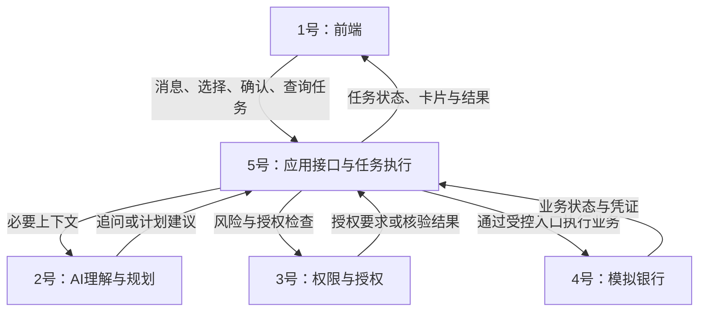

# 智能转账｜团队分工与接口对齐工作记忆

版本：v0.1  
整理日期：2026-09-16  
用途：转发给团队成员或其 AI partner，恢复讨论背景、安排协作、对齐接口。  
来源：本次关于架构、垂直／水平分工、五人职责及接口契约的聊天讨论。未重新审阅全部需求主稿或核验赛事规则。

**状态说明：这是一份讨论交接文件。五人角色、接口边界和开发顺序均为建议方案，尚未绑定实际成员，也不代表团队已批准、接口已冻结或功能已实现。**

## 1. 一分钟恢复上下文

- 最新讨论方向：最终目标仍为六类场景，先全队完成智能转账，建立公共基础，再分别扩展其余五类。
- 早期 v0.3 需求文档以转账、账单、订阅三类为首版暂定基线；最新聊天提出最终六类。正式交付范围需要同步到统一需求文档，不能把两个口径混用。
- 本次建议先完成即时转账：自然语言输入 → 必要追问 → 确定参数 → 展示详情 → 确认／强验证 → 模拟执行 → 核对 → 返回结果。
- 五人暂按技术模块分工：1号前端、2号 AI 理解、3号权限授权、4号模拟银行、5号任务执行与联调。
- 转账做通后，以业务场景为单位指定负责人；公共模块继续由原维护人负责。
- 每个人负责自己模块的实现、接入与测试。5号组织联调，不包办所有人的接入和缺陷修复。
- 先统一接口语义和共同样例，再分别开发；暂不固定语言、框架、API 路径、最终字段拼写或工期。

## 2. 为什么这样分工

| 分工方式 | 优点 | 本项目的风险 |
|---|---|---|
| 垂直：一人负责一个业务场景 | 对完整体验负责，方便并行 | 初期容易各写一套确认、权限、状态和异常处理 |
| 水平：按前端、后端、AI、测试分工 | 发挥专业优势，统一公共能力 | 一个流程需要多人接力，容易等待且缺少整体负责人 |

建议分阶段采用：**转账阶段按模块协作，并指定5号为流程负责人；后续按场景负责，继续共享公共能力。**

场景负责人负责需求边界、接入、测试、演示和验收，不要求一个人独自编写所有前后端代码。团队技能分布不同，可以配对开发。

不单设一个人只负责测试。可以指定测试协调人维护用例和组织回归，但模块负责人仍对质量负责。

## 3. 当前范围与暂缓内容

### 3.1 本阶段建议范围

- 人民币即时转账，金额大于零，最多两位小数；内部按整数“分”处理。
- 付款账户、唯一收款人、金额的明确识别及必要追问。
- 同名联系人选择、上下文指代和参数纠正。
- 黄色确认、红色详情同意加可信强验证。
- 持久化余额与流水、幂等提交、业务结果查询。
- 余额不足、授权过期、旧确认失效、累计风险升级、重复提交。
- 扣款后响应丢失、进程重启恢复、取消未提交步骤。
- 最小人工接管：领取、查询核对、请求重新授权、反馈或交还任务。

### 3.2 本阶段不默认纳入

一次性定时、周期转账、AA、跨币种、真实跨行清算。它们是否属于最终交付、在哪个阶段完成、由谁负责，须单独登记，不能默认为永久取消或无人负责。

强验证采用可替换适配器。模拟认证测试通过不等于正式赛事验收认可。

## 4. 五个人的具体职责

| 角色 | 主要工作 | 具体交付 | 主要协作对象 |
|---|---|---|---|
| **1号：前端与交互** | 对话、联系人／账户选择、详情卡片、确认／验证入口、进度、结果、刷新恢复、最小操作员页面 | 用户端及操作员交互；可复用确认卡片、任务面板和结果组件 | 5号为主要接口方；与2号设计追问，与3号设计验证体验 |
| **2号：AI理解与规划** | 意图识别、参数提取、同名消歧、必要追问、上下文纠正、结构化计划、结果解释 | 模型适配、计划建议结构、追问与对话样例、理解测试 | 5号提供上下文和受控工具；与1号对齐展示 |
| **3号：权限与授权** | 身份与归属、风险分级、确认绑定、强验证、授权失效、风险占用规则、受理时核验 | 可复用策略、授权凭据与认证适配器；风险及授权边界测试 | 与5号共同完成原子受理；与4号对齐资金和风险边界 |
| **4号：模拟银行与账务** | 用户／账户／联系人数据、余额、转账、流水、幂等、结果查询、故障注入 | 可持久化的模拟业务能力、可复位数据、账务及并发测试 | 5号调用；2号通过受控工具查询联系人 |
| **5号：任务执行与联调** | 任务／步骤／操作编号、计划版本、调度、状态、受理事务、核对恢复、人工接管、接口统稿 | 完整可恢复流程、任务接口、执行器、工单、联调用例 | 连接其他四人，推动整体验收 |

### 4.1 各角色的完成标准

- **1号**：用户能从表达需求操作到查看结果；等待、失败、未知状态清楚；刷新能恢复展示。
- **2号**：能够把自然语言转成准确的候选参数与计划；缺信息会追问，修改会明确提出变更。
- **3号**：没有相应授权不能执行；旧确认、过期验证、参数修改和并发风险升级均不能绕过检查。
- **4号**：余额和流水一致；重复提交不重复扣款；并发不超支；响应丢失后能查回原业务。
- **5号**：正常和异常链路均连通；超时、刷新、重启不丢失任务、不重复扣款；人工接管可实际继续处理。

### 4.2 不可混淆的责任边界

1. 2号提出参数和计划；3号决定授权条件。模型不能自报验证通过、降低风险等级或判定交易成功。
2. 5号决定何时调用；4号保证同一操作重复调用只产生一次业务效果。
3. 3号管理风险累计口径；4号管理账户余额和账务。风险累计占用与资金占用分别管理。
4. 5号维护任务和操作观察状态；4号维护银行业务状态；3号维护授权状态。
5. 审计事件由各模块产生，5号用统一标识串联；审计不是5号独自补写所有业务日志。

## 5. 统一调用关系

后续接口讨论将调用关系收敛为：**前端业务请求统一进入5号负责的应用接口，由执行系统组织其他模块。**

文字版：1号 → 5号 → 2号／3号／4号；结果由5号汇总后返回1号。

这表示逻辑职责，不要求拆成微服务。初版可采用模块化单体和一个数据库实例。模型不直接访问数据库；联系人等业务查询通过受控工具入口进行。

强验证如需浏览器直连认证服务，最终结果仍由3号在服务端核验。

## 6. 全队必须共用的接口约定

| 事项 | 建议约定 |
|---|---|
| 可信身份 | 从服务端登录上下文取得；不相信模型或请求正文自报的用户编号 |
| 金额 | 接口使用整数“分”，首版仅人民币；展示可换算为“元”；不静默四舍五入 |
| 时间 | 使用带时区的标准时间；累计按北京时间自然日、服务端时间计算 |
| 收款人 | 姓名仅用于查找；执行绑定唯一编号，并将对应详情展示给用户确认 |
| 参数版本 | 修改金额、账户、收款人等关键参数，旧确认失效；未受理的旧操作失效，新操作重新授权 |
| 已受理操作 | 不直接修改参数；继续按原操作核对，新的业务意图另行处理 |
| 幂等 | 同一操作、同一参数只产生一次效果；同一操作标识配不同参数须拒绝 |
| 成功依据 | 银行侧可信结果及业务记录；网络请求完成或模型回复不构成依据 |
| 状态恢复 | 持久化业务事实独立于聊天记录；刷新、重连、重启均能找回原任务 |
| 查询未找到 | 暂时查不到不等于失败；需要证明未受理且以后不会执行，才能按未执行终结 |

### 6.1 四种标识

| 标识 | 含义 | 创建与管理 |
|---|---|---|
| 请求编号 | 一次消息、点击或查询，支持识别重复交互 | 客户端或接入层创建，服务端校验 |
| 任务编号 | 用户要完成的一件事 | 5号 |
| 步骤编号 | 任务中的一个步骤 | 5号 |
| 业务操作编号 | 一笔具体转账，提交、查询、恢复始终关联它 | 5号创建，4号持久化并用于去重查询 |

请求编号与业务操作编号不能混用。同一操作的重试不能生成新的业务操作编号；判断是重试还是新的业务意图，也不能只凭两次金额和收款人相同。

### 6.2 供本次协作沿用的风险默认值

以下来自此前需求讨论，属于内部开发口径；本文件不新增官方认定：

- 同一用户所有模拟付款账户合并累计；不超过1000元走黄色确认，超过1000元走红色详情同意加强验证。
- 判级考虑当日成功转出、所有未终结占用（包含跨日）及本次新增拟转出；同一操作不重复计入。
- 等待用户授权的草稿不占用；正式受理时原子校验并登记占用。
- 成功将占用转为归属日期的成功累计；明确不会扣款的失败／取消才释放；未知结果继续保留。
- 退款不冲减转账风险累计；余额是否足够另行校验。
- 先前需求中的确认有效期、核对次数和时间预算是可配置内部值，团队应在契约中统一，不各自硬编码。

## 7. 五组接口契约

表内为能力名称和语义，不是已冻结的URL或字段定义。

| 接口组 | 提供方／调用方 | 输入重点 | 输出重点 |
|---|---|---|---|
| 用户交互 | 5号提供，1号调用 | 消息、选择、确认卡片标识、参数版本、请求编号 | 任务标识、阶段、待办动作、卡片、结果 |
| 理解与规划 | 2号提供，5号调用 | 当前表达、必要历史、已确定参数、候选对象、计划版本 | 追问、计划建议或修改建议 |
| 权限授权 | 3号提供，5号调用 | 可信用户、对象、金额、参数版本、授权记录 | 风险等级、授权要求、核验结果、拒绝原因 |
| 银行业务 | 4号提供，5号调用 | 操作标识、确定参数、可信执行上下文／凭据 | 业务状态、流水、错误原因、查询依据 |
| 任务查询与事件 | 5号提供，1号调用 | 任务标识、已接收事件位置 | 完整任务快照、状态变化、允许动作 |

每组契约至少包含：用途、负责人、调用方、身份要求、输入输出、校验规则、状态影响、错误、幂等、超时处理和正常／异常样例。

### 7.1 1号与5号：返回状态和下一步动作

不能只返回一句“请确认转账”。应提供卡片标识与版本、结构化详情、当前阶段、允许动作及已完成／待核对／未执行步骤。

页面刷新通过任务快照恢复；事件推送用于及时更新。HTTP请求配合SSE是候选方案，传输协议待定，不同时强制WebSocket和SSE。前端展示结构化可信数据，模型文案不能覆盖收款人、金额或执行结果。

### 7.2 2号与5号：三种输出

- **需要追问**：指出缺失或歧义信息，5号保存等待状态并让1号展示。
- **计划建议**：5号检查参数、工具白名单、权限、依赖和无环性后，保存可执行版本。
- **修改建议**：5号判断操作是否仍可修改；更新版本、失效旧授权，必要时重新确认。

“好的”等模糊确认必须唯一关联到已展示的具体操作，不能由模型猜测。多笔待确认时需澄清。

### 7.3 3号与5号：预检查和正式受理分开

预检查用于决定向用户展示什么授权要求；正式受理使用最新风险与有效授权再次核验。

3号提供风险及授权规则，5号协调受理事务，原子保存：**操作登记、授权消费、风险占用、待执行记录**。完成持久化后再发送业务请求。二者共同评审该边界，不能分别检查后留下并发窗口，也不应在持有数据库锁时等待用户或模型。

### 7.4 4号与5号：提交和查询都必须存在

- 同一操作、相同参数重复提交，返回同一笔业务。
- 同一操作、不同参数，明确拒绝。
- 支持按提交前已知的操作标识查询，不依赖成功响应才产生的流水编号。
- 超时后执行器保留未知状态和风险占用，先查原操作。
- 银行写接口校验可信调用身份及执行上下文，不能仅凭操作编号允许扣款。
- 银行侧余额校验、业务去重、余额更新与流水写入在同一事务中完成。

## 8. 状态、取消与人工接管

| 状态层次 | 负责人 | 示例 |
|---|---|---|
| 任务阶段 | 5号 | 等待补充、等待确认、等待验证、执行中、待人工、已结束 |
| 操作观察状态 | 5号 | 未提交、提交中、处理中、结果未知、成功、失败 |
| 银行业务状态 | 4号 | 已受理、处理中、成功、明确失败 |
| 授权状态 | 3号 | 待同意、待验证、有效、过期、已消费、失效 |

以上为语义示例，正式枚举还需冻结。任务阶段与最终结果应分开：任务结束不自动等于全部成功。

银行可能已成功，而执行器因响应丢失仍显示结果未知；应查询恢复，不能强行把两边都改成失败。

取消任务时停止未提交步骤，在途操作继续核对；已完成转账不能通过修改任务状态撤回。自动核对预算用尽只触发人工处理，不能据此宣告失败或释放未知占用。

人工领取任务时原子取得执行权及版本，阻止智能体继续发起新写操作。人工同样使用受控执行入口，不能替用户授权新转账，也不能直接把未知交易改为成功。结果回传用户后，仍需确认没有未知在途操作才能结束相关任务。

## 9. 三轮共同推进

| 检查点 | 各人重点 | 全队验收 |
|---|---|---|
| 第一轮：固定参数跑通 | 1号确认与结果页面；2号计划结构和样例；3号黄色确认；4号记账查询；5号串联执行 | 固定账户、收款人和金额，确认后余额与流水正确 |
| 第二轮：自然语言与授权 | 接入追问、选择、参数修改、红色验证、最新风险复核 | 自然语言可完成黄色及红色路径，旧授权不能绕过规则 |
| 第三轮：异常与恢复 | 各自补齐重复提交、丢失响应、重启、旧卡片及人工接管 | 不重复扣款、不误报成功，可恢复或由人工实际处理 |

第一轮就连接五个模块。尚未完成的模块使用符合契约的测试替身，随后逐个替换，不等所有人各自完成才联调。

## 10. 共同样例与测试分工

| 样例 | 必须证明什么 | 主要协作 |
|---|---|---|
| 正常转账300元 | 完整链路、可信凭证、余额与流水一致 | 全员 |
| 两个同名联系人 | 不猜收款人，选择后绑定唯一对象 | 1、2、4、5号 |
| 确认后修改金额 | 更新版本，旧卡片失效，重新授权 | 1、2、3、5号 |
| 日累计800元，再转300元 | 升级为红色，并取得本笔同意与强验证 | 1、3、5号 |
| 并发提交导致风险升级 | 按最新累计受理，不能凭旧黄色确认放行 | 3、5号 |
| 余额不足／并发超支 | 不错误记账、不产生负余额 | 4、5号 |
| 连续点击确认 | 复用同一业务操作，只扣款一次 | 1、4、5号 |
| 扣款成功但响应丢失 | 先显示待核对，保留占用，按原操作查回成功 | 全员 |
| 执行中重启 | 找回原操作，已成功步骤不重放 | 4、5号 |
| 跨用户或过期确认 | 服务端拒绝，不依赖前端隐藏按钮 | 1、3、5号 |
| 取消任务／人工接管 | 停止未提交步骤，在途继续核对，执行权互斥 | 1、3、4、5号 |

测试责任：1号负责交互与刷新，2号负责表达与纠正，3号负责权限边界，4号负责账务和并发，5号组织全流程、恢复及接管验收。各人修复自己的模块，并由其他成员交叉复现。

**首选联合验收案例：银行已经扣款成功，但执行器没有收到响应。** 它能同时检查银行事实、未知状态、风险占用、页面反馈、模型解释和恢复语义是否一致。

## 11. 接口文件维护与变更流程

1. 5号维护共享契约总稿，每个提供方维护对应章节，调用方评审是否足够使用。
2. 先共同走正常转账和扣款后响应丢失两条流程，再确定字段和接口。
3. 保存契约v0.1，附统一输入、输出和预期状态样例。
4. 各人提供测试替身并尽早联调，真实模块逐个替换。
5. 接口字段、状态或语义发生变化，先更新契约并通知受影响的人，再修改实现；记录兼容性及受影响用例。

建议契约文件集中管理公共约定、五组接口、错误与状态、共同样例和变更记录。文件名与目录尚未确定。

## 12. 共同阶段何时结束

- 即时转账黄色、红色流程均可独立演示。
- 关键异常、账务一致、幂等、授权和恢复用例通过。
- 另一名成员能按说明启动、复位数据并重演故障。
- 公共模块与转账场景逻辑分开，其他场景知道如何接入。
- 对其他五类做契约适配检查：列表／图表、已受理未完成、任务依赖等能够表达，不能只支持“转账成功”字符串。
- 公共模块有持续维护人；定时、AA等后续功能有明确安排或标记待决定。

## 13. 团队下一次需要填写的事项

| 待确认项 | 当前状态 |
|---|---|
| 五位成员对应1—5号及备份／配对关系 | 未分配 |
| 5号是否担任流程和接口总负责人 | 建议，待确认 |
| 团队主要语言、前端和后端技术栈 | 未确定 |
| 六类最终交付范围及各类子功能 | 最新聊天方向为六类，需同步正式需求 |
| 本阶段即时转账边界 | 建议作为首个共同检查点 |
| 定时、周期、AA的阶段和负责人 | 未确定 |
| 授权有效期、核对预算、锁定条件 | 沿用需求默认值前需统一登记、配置化 |
| 模拟认证实现与正式验收要求 | 实现方案待定，验收认可未确认 |
| 接口最终字段、状态枚举、传输协议 | 由提供方和调用方共同冻结 |
| 三轮检查点日期与联调安排 | 未排期 |

## 14. 交给下一位 partner 的使用说明

请先基于本文件恢复背景，区分已讨论方向、建议方案和待确认项。接手某个角色时，先检查共享契约、仓库现状及其他成员已经完成的工作，再推进自己的部分。

不要默认把本文视为已经冻结的产品规格，不要未经协作修改公共金额、身份、授权、状态或幂等语义。发现缺项时，提出具体的契约修改和受影响用例，交由提供方与调用方共同对齐。

本文形成时仍处于文字与架构讨论阶段，没有因本文而启动项目代码开发。
