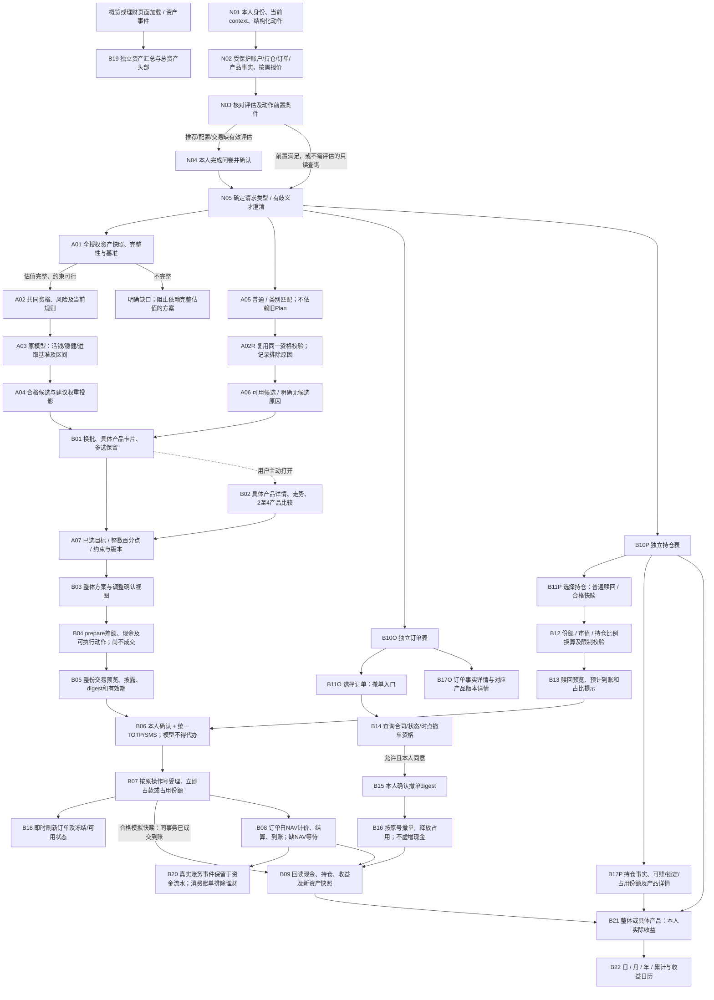

# 理财场景：NLP与执行Agent接入交接、完整业务DAG

文档更新：2026-10-16（多伦多）；资料/源码核对版本：2026-10-15；核对源码基线：`95b14b21e2fa61c777b57dd8075395aecd958689`。

对应PR：[PR #12](https://github.com/Stainnifuski/2026-Fintechathon-ai-banking-agent/pull/12)，已由用户在GitHub合并，当前远端main为`4ae64ab990bfc8d79a160be6735f54ed0bb5b7ea`，包含上述核对源码基线。本文依据当前01/02集成代码和最新范围修正，不将旧任务书、旧语义提示词或开发步骤当成当前业务契约。

## 1. 先看结论与职责

当前最新版手动业务已接通：正式风险评估、受保护银行事实、通用/类别推荐、换批多选、详情比较、整体配置和整数调整、差额prepare、整份确认与统一MFA、申赎撤单、订单持仓、流水/账单边界、实际收益及日历。

**新统一Agent优先调用`POST /api/v1/wealth/actions`。** 它接收严格结构化动作，不解析自然语言，不会因为用户在聊天中说“同意”就成交。01的整体配置接口和02的银行交易接口也可由受控执行器显式编排；同一动作选一种路径调用，避免重复准备或创建会话。

|角色|负责|不能替代|
|---|---|---|
|NLP/统一Agent队友|多轮理解、指代/更正、意图与参数草稿、必要澄清、跨场景总任务与依赖、工具选择、解释服务端结果|不能编造现金、风险等级、NAV、成交结果、确认/MFA证据|
|01配置服务|资产快照、产品资格、已确认配置方法与权重投影、候选、方案版本及约束|不接管银行受理/账本，不让LLM计算比例代替服务端|
|02交易服务/共用银行|事实读取、差额、预览、本人确认与MFA衔接、幂等受理、结算、申赎撤单和账务|不根据NLP自由文本直接写现金/份额|
|本人可信UI|问卷作答/确认、完整交易披露、整份确认、TOTP/SMS验证|不是Agent自动调用的“已同意”工具|

### 当前代码中必须分清的两条路径

1. **当前推荐接线**：`/actions` → 注册的`JointPortfolio` handler → 新01资产配置/候选 → `wealth_selection.prepare` → 原02执行计划及银行。
2. **旧语义能力**：`/messages`、`/subtasks`及`wealth-semantics-v1`、既有持久化任务引擎仍有代码。旧通道按预算、期限等处理旧规划需求，**不能据其存在就宣称已接通最新01整体配置**；本轮也未做新DeepSeek/统一NLP实测。新接线应复用其任务控制和依赖能力，逐项对齐下面当前动作契约，不原样照搬旧提示词。

特别注意：新`PortfolioCreate/PlanParams`没有“本次投入金额”、必填期限或用途。整体基准是全部授权关联银行资产，而非用户随口报的数字。用户说“我有1000元”不能覆盖银行资产；说“只买1000元”也不能把`basis_fen`改成100000。该语义是单产品明确申购、整体目标调整，还是预算型新需求，需要区分；当前新01接口没有通用预算字段，不得塞入不存在的参数，或绕回旧`/plans`假装是同一新配置链。新的金额/目标语义映射未覆盖时应说明/澄清，再与01/02确认接法，不擅自重选算法。

## 2. 环境、身份、值与版本

- 开发人工入口：`http://127.0.0.1:3014/`；对应API：`http://127.0.0.1:8014`；OpenAPI：`/openapi.json`、交互文档：`/docs`。这些是本机专用端口，不是队友机器的公网服务。
- 用户身份来自`Authorization: Bearer <access_token>`，不是模型提供的`user_id`。Agent不能持有或调用`/api/v1/internal/bank/...`内部令牌/管理结算接口。
- 先`GET /wealth/contexts`读取`selected`及本人context；当前正式界面自动选择已有比赛环境，不恢复旧账本下拉。会话/context/资产scope变化要重新读取，不能让语言模型自行选别人的账户。
- 金额为**整数分**；份额用四位精确字符串，如`"10.0000"`；净值和比例用精确字符串。`"0.45"`表示45%，不是`45`。
- 手动比例只接受整数百分点；按服务端返回区间向内取整。普通调整保留原U，明确重设偏好才用`revision_kind="preference"`。初始模型权重/金额保持原精度，不批量取整或偷偷改别的产品凑合计。
- UTC保存/传输事件瞬时；业务日期及页面显示按北京时间。`nav_date`是真实公布净值日期，不用抓取时间替代。
- `null/partial/unavailable`不是0。历史净值不足两点不画趋势图；产品行情收益指标与本人实际持仓收益不是同一概念。

|标识|来源与用途|不能混用|
|---|---|---|
|action `request_id`|客户端同一次结构化动作的幂等键|改参数用新ID；未知结果不换ID重提|
|`session_id/session_version`|`/actions`返回的会话及CAS版本|不是候选会话、Plan版本或task版本|
|`candidate_binding`|CandidateGroup的`session_binding`映射得到|换批需原filter、cursor及候选版本|
|`portfolio_id/version/snapshot_id`|01整体目标方案及资产快照|不是02的执行`plan_id`|
|`plan_id/version`|prepare返回的银行执行计划|必须用此版本预览/确认/验证/执行|
|`authorization_id/digest/disclosure_version`|可信银行预览返回|禁止模型生成、串用、修改后继续用旧授权|
|`operation_id`|银行命令/订单原操作号|超时只按原号查询，不换号补单|
|`task_id/version`|持久化执行DAG及控制状态|不是action的会话版本|
|产品/订单/持仓选择|产品`code:version`；订单operation_id；持仓position_key|三种ID不能互换；保留具体产品版本|

## 3. 主工具：结构化动作接口

路径：`POST /api/v1/wealth/actions`；请求`WealthActionV1`，响应`WealthActionResultV1`。所有未定义字段拒绝。完整机器schema见同目录`nlp_agent_openapi_20261015.json`，来自当前8014实际OpenAPI的相关路径及传递引用闭包，不包含访问令牌或业务数据库。

```json
{
  "schema_version": "wealth-action-v1",
  "request_id": "wealth-demo-000001",
  "context_id": "<当前本人context_id>",
  "action": "recommend_products",
  "params": {"filter": {"mode": "general"}}
}
```

首轮可省略会话；后续同时传`session_id`及`expected_session_version`，每次使用上次响应的最新`session_version`。不要一半提供、一半遗漏。可以传`selection_context:{"object_type":"products|orders|positions","ids":[...]}`，但只有消费这些对象的动作才传；`plan_portfolio/recommend_products`的已选产品放`params.selected`，不要放selection_context（当前handler会拒绝）。

|action|params核心字段|结果与副作用边界|
|---|---|---|
|`plan_portfolio`|`selected?`、`candidate_binding?`、`growth_ratio_ex_cash?`|生成整体PortfolioPlan，尚不交易；不接受budget/horizon字段|
|`recommend_products`|`filter`、`cursor?`、`candidate_binding?`、`selected?`|CandidateGroup；支持无旧Plan推荐；selected用于跨批保留具体产品|
|`revise_portfolio`|`selection: PortfolioSelection`|校验并生成新版本；失败保留原方案；不改已受理订单|
|`show_product_detail`|`product_id/product_version`或单一selection；`period=1m/3m/1y`|具体版本资料与按需历史；不会申购|
|`compare_products`|`product_ids`，2—4个不同代码|对照实际字段；非A/C切换，不承诺自动切份额|
|`list_orders`|`page`、`page_size`|订单独立分页、scope_key及table_data；缺页码/页大小会clarify|
|`list_positions`|`page`、`page_size`|持仓独立分页，可赎/占用/锁定份额和估值；position_key由银行事实构造|
|`show_wealth_returns`|`scope=all/product`、`product_id?`、`period=day/month/year/cumulative`、`anchor_date?`|本人实际收益及points；scope=product必须给代码，all不能夹代码|
|`prepare_purchase`|`portfolio_id`、`expected_version`、`snapshot_id`、`payment_account_id?`|01目标→02差额/执行计划；可创建草稿/任务，但不创建银行订单或占款|
|`preview_redemption`|`redemption: RedemptionDraft`，可配positions选择|必要信息缺失clarify；可生成预览授权/任务，不成交或冻结份额|
|`preview_order_cancellation`|`operation_ids`或orders选择|仅查询逐笔撤单资格；不是实际撤单|

响应外层：`schema_version, request_id, context_id, session_id, session_version, action, status, message, data, required_fields, allowed_actions`。

- `status=ok`只表示**该动作**完成；对推荐/prepare绝不等于申购成功。
- `clarify`：使用`required_fields[].field/reason/options`让用户补真正缺项；不是自行填默认值。新一轮回答形成新请求ID和新会话版本。
- `blocked`：按`data.code`解释阻塞，不能填fixture或执行其他接口绕过。
- 部分失败直接以HTTP 4xx/5xx、`detail.code/message/evidence`返回，不一定经过外层status；两种错误形态都要处理。

### 推荐、换批、Plan与修订细节

- filter当前使用`mode=general`，或`mode=category`配`quick_redeem/bank_wealth/bond_fund/mixed_fund/equity_fund`；可用bucket=`cash_management/stable/growth`。schema仍残留theme等历史字段，**主题/高股息已范围调整取消，不开放为新Agent能力**。
- 换批保存`next_cursor`和`session_binding`，映射为`candidate_binding:{session_id,expected_version:version,filter}`。同一服务可能同时有action会话和候选会话，分别保存。
- `selected`项：`{product_id,product_version,share_class}`，share_class可null。沿用实际返回值；A/C历史字段用于身份/版本，不能恢复A/C替换、默认A或强制家族前置。
- `PortfolioSelection`：`portfolio_id,expected_version,snapshot_id,context_id,items,revision_kind`，可带`cash_residual_fen,growth_ratio_ex_cash`。items含`product_id,product_version,share_class,target_ratio_total`。比例是**总资产口径**；growth_ratio_ex_cash是**剔除活钱后的进取比例**，不是总资产的进取比例。
- 例如服务端范围40.2%—59.8%，用户仅能调整41%—59%。45%并不直接得到总资产45%股票；由服务端依据活钱、原U和投影算出。模型不能代填可行区间、改风险等级或把小权重当作风险豁免。

## 4. 直接HTTP接口与交易工具分层

以下均相对`/api/v1/wealth`。供执行器/可信UI适配使用，不是让LLM自由选择任意写接口。

|方法/路径|主要输入|使用位置|
|---|---|---|
|GET `/contexts`|Bearer|本人当前scope；select写入仅复用既有本人环境选择逻辑|
|GET `/asset-summary`、`/assets`|Bearer|独立资产头部；现金/持仓/订单/范围与缺失信息|
|GET `/portfolio/snapshot?context_id=...`|当前context|A01全授权AssetSnapshot；估值不完整不造总额|
|GET `/questionnaire`、GET `/assessments/current`|Bearer|读正式问卷及当前评估|
|POST `/assessments`|questionnaire_version/profile_version/adult/full_capacity/answers|本人填正式问卷；Agent不代答|
|POST `/assessments/{id}/confirm`|本人动作|本人确认评估；不得从聊天推定|
|POST `/portfolio/recommendations`|PortfolioRecommendation|独立普通/类别推荐、换批|
|GET `/portfolio/products/{code}?context_id=...`|具体代码|手选也走相同资格；拒绝越级，不是白名单绕行|
|POST `/portfolio/plans`|PortfolioCreate|创建A方案|
|GET `/portfolio/plans/{id}?context_id=...`|A方案ID|读取A当前方案|
|PUT `/portfolio/plans/{id}`|PortfolioSelection|修订A方案版本|
|POST `/portfolio/plans/{id}/prepare`|expected_version/snapshot_id/payment_account_id?|准备B执行计划，不成交|
|POST `/plans/{plan_id}/preview`|`{version}`|整份交易预览；返回逐笔授权、digest、披露、估算及有效期|
|POST `/plans/{plan_id}/confirm`|`{version,items:[{authorization_id,digest,disclosure_version,accepted:true}]}`|由本人确认全部披露；不是模型工具自动签名|
|POST `/plans/{plan_id}/verify`|`{version,proof,method,challenge_id?}`|受控验证码通道；method=totp/sms|
|POST `/plans/{plan_id}/execute`|`{version}`|验证后按原号提交；可能部分受理，不能宣称整批原子全成功|
|GET `/plans/{plan_id}/progress`|原计划号|按原操作号核对；卖出/买入阶段不能跳过到账条件|
|POST `/redemptions/preview`|RedemptionRequest|将份额/市值/持仓比例转换为合法命令及预览授权|
|POST `/previews`|InvestmentCommand|已有明确具体单笔命令的原预览；新整体配置优先走prepare/整份链|
|POST `/previews/{authorization_id}/confirm`|PersonalConfirmation|单笔本人确认|
|POST `/previews/{authorization_id}/verify`|StrongVerification|单笔统一MFA|
|POST `/previews/{authorization_id}/execute`|原授权号|单笔按原号执行|
|GET `/orders/{operation_id}`|原操作号|可信订单结果；网络超时后优先查原号|
|GET `/orders/{operation_id}/cancellation-eligibility`|原操作号|合同、时点及状态核对|
|POST `/orders/{operation_id}/cancel`|PersonalConfirmation|本人确认后实际撤单；资格不是授权|
|GET `/returns`|ReturnsQuery查询参数|整体/单产品日月年累计及日历数据|

统一认证另位于`/api/v1/auth`：login/me、totp/status/enroll/confirm、sms/send；具体请求以附件OpenAPI为准。TOTP未绑定时走本人绑定或既有SMS方式，不能编造固定验证码，不能恢复临时“点击模拟授权”。验证码、TOTP种子、短信挑战凭证不进入模型上下文/聊天/日志；统一SecondFactor可信组件完成，NLP只接收验证状态和脱敏回执。

### 赎回参数

`RedemptionRequest`包含`schema_version="wealth-redemption-request-v1",context_id,position_key,input_mode,redemption_mode`；`input_mode`只能为units/market_value/holding_ratio，并**只填对应一项**：`units="10.0000"`或`market_value_fen=100000`或`holding_ratio="0.5"`。redemption_mode=standard/quick；“尽快”不自动等于快赎，产品能力、窗口、每日额度和可赎份额仍由银行判断。

市值输入是换算请求，不是到账承诺。正式InvestmentCommand赎回金额必须为0、份额为正；quick使用v2及当前报价/context绑定。采用预览返回的原command，不由模型复制后改份额。模拟快赎成功同事务减份额、加现金并生成唯一到账流水，成功不可撤；普通赎回按期限和计价/到账规则，不用测试时钟制造可卖状态。

### 状态与回执

`AWAITING_CONFIRMATION/VALID`等是草稿/授权状态，不是订单成功。订单至少区分ACCEPTED、PENDING_PRICING、PENDING_CASH、SETTLED、CANCELLED及服务端失败/未知状态。受理后应展示即时占款或份额占用；仅SETTLED及实际到账事实可用于“已结算/已到账”。未公布订单净值日NAV必须等待，不能用最新预览NAV或固定旧NAV强行结算。

多个动作不是跨产品原子事务。若部分结果未知，保存原plan_id/operation_id并查询/恢复，禁止新ID自动重下；不能为恢复用户体验伪造整份成功。已受理订单不随自然语言改方案、关闭聊天或回退任务而撤销。

## 5. NLP与上层编排建议

以下是**接入设计建议，不是声称新增API已经实现**：

1. 模型先产出受限意图、参数草稿、指代来源和歧义；执行器按当前UI选择、最新工具返回及权限核实。
2. 当前未提交方案、候选集合/顺序、上下文、版本分别保存；“第二只”“换一批”“改到55%”从最新可见对象解释，不能凭聊天名称臆造代码。
3. 同义、否定、更正、复合需求用语义处理，不做固定关键词白名单。仅澄清影响下一步的歧义。旧SemanticFrame已有set/clear/mark_unknown/skip可参考，但不是新/actions可直接接收的字段。
4. “看看持仓/收益”只读；“买/卖”先返回选择/预览；口头“确认/帮我验证”不能设置accepted、proof、授权状态或越过可信UI。
5. 上层跨场景如“先交房租再配置剩余资产”，先由对应执行器取得银行完成事实，随后重读资产；不要把租金从旧快照手工扣掉。重新规划不是重复转账。
6. “只看建议”“先别买”不得被规划结果隐式升级为交易。用户修改未提交方案后，旧预览失效并重新确认；已受理交易只允许按原订单查询/合法撤单。
7. 报错给中文与下一步；保留内部code供机器判断。不可把资格失败统一翻译为“预算不足”。

|典型错误|面向用户的下一步|执行器行为|
|---|---|---|
|ASSESSMENT_REQUIRED/FORMAL_ASSESSMENT_UNAVAILABLE|先本人完成/确认正式风险评估，再继续推荐或配置|不代答、不从“我很保守”改等级|
|PRODUCT_SELECTION_REJECTED/风险超限|该产品不符合当前等级，请选等级内产品|手选、极小/0权重不能放行|
|BANK_PRODUCT_CONTENT_MISMATCH|产品资料绑定不一致，停止准备并核对资料版本|不得把拒绝写成暂无产品，或直接改预期hash|
|STALE_CONTEXT/STALE_SESSION/STALE_PORTFOLIO|范围/方案已更新，请刷新并重新核对|取新版本，不重复自动写请求|
|NAV_UNAVAILABLE/估值partial|当前报价/估值不足，显示最近可靠日期或缺口|已有持仓不丢弃、不估0；只读合法推荐可独立进行|
|期限/窗口/额度/可赎份额不满足|说明实际限制与可继续时间/方式|不改业务时钟、不改产品规则|
|超时/UNKNOWN/RECONCILIATION_REQUIRED|结果待核对，正在按原订单查询|不换operation_id重提，不宣布失败后自动补单|

## 6. 持久化DAG与旧子任务接口：可复用及缺口

已有`wealth_tasks/wealth_task_nodes`、暂停/恢复/回退/取消控制及银行事实回查；整份prepare会登记执行任务。整体A方案目前使用`MemoryPortfolioStore`，候选会话也在进程内；**不能声称A草稿/候选跨服务重启自动恢复**。B准备后的执行计划、授权、订单及持久任务与A内存草稿分开。新Agent须把丢失的草稿作为重新规划处理，不重建已提交订单。

旧子任务接口保留供代码适配参考：

- POST `/subtasks`：`schema_version=wealth-subtask-v1,request_id,raw_text,context_id`，可带parent_task_id、session_id/version、parsed_intent、external_dependencies。**raw_text仍必填**；typed方式是`parsed_intent`对象，不是顶层intent字段。
- GET/PATCH `/subtasks/{task_id}`；PATCH需request_id/expected_version/raw_text，可带parsed_intent。旧Intent.semantic使用wealth-semantics-v1。task version与session_version分别消费，不能混用。
- POST `/subtasks/{task_id}/external-completed`：request_id/expected_version/parent_task_id/node_id/event_reference。只接受核验后的本人转账完成流水引用，不接受`paid=true`或客户端金额替代银行事实；完成依赖后重新读取现金。
- task控制为`/tasks/{task_id}/{pause|resume|rollback|cancel|handoff}`等既有服务端能力。客服领取/交还、主任务选择、旧调试对话UI已取消，不把这些重新开发成验收前置。

这些接口尚需队友验证与新/actions、候选绑定及A方案生命周期的组合接线；本文不以历史DeepSeek测试结果证明新组合已联调。业务DAG节点与runtime节点不是一对一：READ_FACTS、RESEARCH、REQUIRE_INPUT、ASSESS、PLAN、CONFIRM、VERIFY、SUBMIT、SETTLEMENT、REREAD_CASH、BUY_PLAN、RESULT等复用原引擎；外部事件保留已有等待节点。每次修订产生新版本依赖，历史已完成节点不可原位改写。

## 7. 最新版完整业务DAG

下图由01第10节共同图对照当前实现修订，完整保留所有编号。移除主题/A-C/客服等已取消范围；B19独立于对话/推荐加载。图中的“刷新/下一轮”是新快照/新版本的后续调用；真正持久化任务须展开为有序依赖，不能在同一版本插入有向环。



### 全节点交接索引

|编号|接口/组件接法与完成边界|
|---|---|
|N01|JWT、contexts、WealthActionV1；统一NLP由队友接入，保留selection/session版本|
|N02|assets/asset-summary；固定产品静态资料首读复用，报价仅查展示、所选、持仓及相关订单代码|
|N03/N04|assessments/current、questionnaire、assessments及confirm；正式评估不由聊天替代|
|N05|actions dispatch；clarify/blocked及严格params；不恢复旧表单或客服入口|
|A01|portfolio/snapshot；借记账面现金＋持仓市值＋赎回应收，冻结不重复计入；总资产≠可支付现金|
|A02/A02R|同一qualify_purchase；R2不能买R4，手选、0/极小权重不得绕过；A02R只是推荐分支复用标记|
|A03/A04|PortfolioModelProvider、原U/ETA=.25/DELTA=.01及投影；LLM只解释，不重选参数|
|A05/A06|recommendations，general/category及原因；不恢复主题、高股息、真实货币、文本DPP/MMR门槛|
|A07|PortfolioSelection；整数百分点、区间向内取整、原U、失败保留、成功升版本|
|B01/B02|ProductPicker等当前组件；保留所选，按需详情/历史/比较；无A/C切换，指标缺失则隐藏|
|B03/B04|AllocationReview/PortfolioAllocation、wealth_selection.prepare；目标不是“全部新增买入”|
|B05/B06|PlanExecution/SingleTradePreview与SecondFactor；一次整份确认/MFA覆盖绑定的逐笔命令|
|B07|银行accept_many等原受理；现金/可赎份额动态再核验；幂等按原号，不保证整批原子|
|B08/B09|原结算/进度核对与回读；未公布NAV等待，卖出到账后重读，再准备/确认下一阶段买入|
|B10O/B10P|独立订单/持仓表，独立行ID、分页、跨页选择；不能把产品代码充当持仓键|
|B11O/B11P|撤单与赎回分别消费orders/positions选择，不混用|
|B12/B13|RedemptionRequest/Preview；普通规则和合格模拟快赎分别核验，金额不是保证到账|
|B14/B15/B16|cancellation-eligibility → 本人确认 → cancel；ALLOWED不是已撤单|
|B17O/B17P|事实详情与产品详情区分，持仓可进入单品实际收益|
|B18|受理后立刻重读；在途份额不能展示为可赎|
|B19|独立AssetSummary缓存与两页头部，不等问卷/聊天/推荐完成；B18/B09及资产范围变化后更新|
|B20|共用Transaction流水；理财本金/申赎现金事件不计消费账单；不得删除原流水实现排除|
|B21/B22|returns scope/period/anchor_date；真实持仓现金流，含已赎回贡献；缺估值标partial/null，日历只消费返回points|

## 8. 固定资料包：队友如何获取与启动

### 获取和版本匹配

源码已通过PR #12合入main，合并提交为`4ae64ab990bfc8d79a160be6735f54ed0bb5b7ea`；上述95b14b2是本次接口核对的修复版本。**固定包通过[GitHub Release](https://github.com/Stainnifuski/2026-Fintechathon-ai-banking-agent/releases/tag/wealth-offline-data-20261015-v2)分发，不进入Git历史**。只下载仓库“Source code ZIP”不会带上`.deps`固定快照。下载Release中的一键交接包，或单独的资料资产：

`wealth-final-offline-20261015-disclosure-v2.zip`

SHA256：`63094dcbefbc4e92745859db095458fa6e29a10019844b17fe4bc41bc8655184`。

Release正文记录匹配源码、资料DATA/DAILY、ZIP校验值和安装步骤。固定资料资产保持原SHA256；一键交接包使用独立校验值。大ZIP不例行commit进Git历史。它是开发交付资料，不是无需依赖/配置的桌面安装程序；发布数据资产不等于自动合并代码PR。

### Windows一键安装固定资料

队友从Release下载并解压`wealth-offline-handoff-20261016.zip`，双击根目录`install_wealth_offline.cmd`：

1. 若不在源码根目录，弹窗选择已克隆并匹配版本的银行项目目录。
2. 安装器自动找到同包ZIP，优先使用项目`.venv`/`venv`中的Python，否则使用PATH中的Python。
3. 自动核验固定ZIP的SHA256、项目配置、资料版本及完整快照schema，再调用原安装器。配置不一致停止，不覆盖源码config；已有同版本会校验并复用。
4. 终端显示安装成功及快照目标目录后，按项目原启动方式启动服务。

本入口只安装固定资料，前提是项目Python依赖已装好；不会自动安装软件、改`.env`、初始化账户/MFA、修改数据库或启动服务。缺依赖会明确提示。macOS/Linux或需要手动排错时用下面的原CLI。

机器协议补充`nlp_agent_action_schemas_20261015.json`含11种动作各自完整的独立JSON Schema；OpenAPI中params是通用对象，不能据此忽略服务端逐action的严格校验。

### 手动安装（从匹配源码仓库根目录运行）

先使用团队支持的Python/Node与独立数据库；安装`backend/requirements.txt`、`requirements-market.txt`，前端目录`npm ci`。密钥、数据库URL、JWT/内部银行令牌及MFA配置由队友按团队规范配置，不复制交接人的.env或运行库。

PowerShell校验：

```powershell
Get-FileHash -Algorithm SHA256 -LiteralPath '<下载目录>/wealth-final-offline-20261015-disclosure-v2.zip'
```

解压到独立临时目录，不覆盖Git当前配置；包里的公开config用于校验，正常应与匹配源码一致。不匹配时先核对源码版本，不跳过校验。

```shell
python scripts/wealth_portfolio_package.py install --manifest "<解压目录>/package/d59ecfcc2ecb09e6573278d5b5f38524407f2ac72ac0051ebf7e7b63f53ff3e1.package.json"
```

安装后基础DATA=`d59ecfcc2ecb09e6573278d5b5f38524407f2ac72ac0051ebf7e7b63f53ff3e1`，DAILY=`5a1f10fea14d1691fc2341df93536d4550d03e2214f1ed390ddd7ec89dc4b5f8`。银行补充后运行DATA=`e08200a8427a1a80f635bcc993d563c9660dacb4cb590f8c67153ff919ab6e83`，DAILY=`d351efa228b2b9b0d42f77fbded651cd6eaf68463ef5fb1953ff34a85bbc91f9`。旧PORTFOLIO_DATA_VERSION/PORTFOLIO_DAILY_VERSION覆盖应移除，或两者按当前基础版本成对配置。

包包含13,578普通真实基金质量交集及19个模拟银行定义；不含密码、密钥、运行数据库、原始全量缓存或真实货币产品。目录身份总数27,070不等于27,070个可交易产品；13,578也不是永久可买承诺。正文/风险/状态/价格/现金仍须运行核验。

在已完成正常表结构迁移、创建合法本人演示用户及其银行账户并设置独立DATABASE_URL的前提下，按现有CLI导入资料并绑定同一银行账户，不恢复采集/worker：

```shell
python -m backend.app.services.bank.wealth_data_cli import --import-root . --file config/wealth/paper_products.json
python -m backend.app.services.bank.wealth_data_cli bind-account --user-id <本人演示ID> --account-id <本人已有银行借记账户ID> --dataset-key real-public-paper-v1:b498da40b510a409211716f0
python -m backend.app.services.bank.wealth_bank_supplement_cli --user-id <本人演示ID> --context-id <上一步返回context_id>
python -m uvicorn backend.app.main:app --host 127.0.0.1 --port <后端端口>
```

设置BANK_API_BASE_URL指向实际银行后端，前端按现有Vite代理启动。仅导入数据不等于已创建登录账户、完成风险问卷或绑定MFA；这些分别完成，不能使用本机验收服务器源码中的账号当作团队生产账号。配置示例以仓库.env示例与README为准，不把本机冻结测试时钟带过去。正常启动使用真实当前时钟；隔离测试context的模拟日期与生产时钟分开。

当前包已实际禁网空目录安装及逐字节重复导出通过；**不代表新队友电脑依赖、数据库和MFA自动配置完成**。在线NAV接口失败时保留最近可靠值/日期，必要时阻止依赖完整估值的确认，不保证断开互联网仍有实时行情。

## 9. 建议队友的最小接线验收

1. 先跑查询：同JWT/context读资产、订单、持仓；跨用户/context、错误对象类型拒绝；不要求为查询先填投资目的。
2. 有效正式评估下general/category推荐、无旧Plan推荐、换批保留选择，按具体代码核对000003/671030/B017；不从全量搜索结果推定可交易。
3. 详情/走势/比较关闭后当前选择及方案保留；模型引用只能来自实际返回资料。
4. 01配置→整数45/55等合法修订→prepare；不修改原U，不造预算；prepare后无银行订单或占款。
5. 本人可信UI完成整份确认与统一MFA，执行器只提交绑定原号；成功受理与已结算分开描述；未知结果用原号核对。
6. R2→R4的手选、0/极小比例及不同具体份额均拒绝；同版本改披露正文可识别，行情更新不触发静态误拒。
7. 普通赎回的期限/份额/在途正确，合格快赎立即到账、唯一流水、成功不可撤；撤单资格与真正撤单分开。
8. 赎回到账后再规划/买入，重读当前现金并重新确认；取消/暂停不回滚已完成交易；关闭聊天或服务重启不重建已提交订单。
9. AssetSummary、头部、持仓和实际收益口径一致，理财现金事件留流水但不进消费账单；日/月/年/累计和日历一致。
10. 至少覆盖样例之外的表达、否定、更正和复合需求。真实LLM联调要另记模型/时间/用例结果，不能拿旧LLM记录或156项银行回归当作新NLP通过。

## 10. 证据与代码导航

- 当前披露修复：`docs/validation/wealth_disclosure_fix_20261015.md`及对应fingerprints JSON；156项受影响检查通过，原失败断言未改。实际HTTP推荐/换批/Plan/prepare通过，prepare零订单/占款；不等于本轮做了新的LLM联调。
- 当前工程边界与完整联合验收：`docs/wealth/portfolio_handoff.md`、`wealth_joint_acceptance.md`。
- 动作schema/实现：`backend/app/schemas/wealth_action.py`、`services/orchestration/wealth_actions.py`；路由`routers/wealth.py`。
- A接口：`schemas/wealth_portfolio*.py`、`routers/wealth_portfolio.py`、`services/orchestration/wealth_portfolio_joint.py`及lifecycle。
- B桥接与执行：`schemas/wealth_selection.py`、`wealth_redemption.py`、`wealth.py`；`services/orchestration/wealth_selection.py`、`wealth_plan.py`、`wealth_execution.py`。
- 银行事实/行情/计价：`services/bank/wealth_service.py`、`wealth_quotes.py`；静态披露：`domain/wealth_product_content.py`。
- 旧语义/任务参考：`services/ai/wealth_model.py`、`domain/wealth_requirements.py`、`schemas/wealth_subtask.py`、`routers/wealth_tasks.py`、`services/orchestration/wealth_task.py`。历史MD的预算/主题/A-C/模拟授权措辞与本文冲突时不沿用。

交接材料、机器schema和安装器随独立代码PR交付，固定资料及一键交接ZIP随Release资产分发。不改理财业务代码，不执行交易，不自动合并main。

一键资料安装实测：独立目录禁网首次安装、重复安装、损坏ZIP拒绝、公开配置冲突拒绝及原快照保留通过（49.48秒）；Windows PowerShell→Python完整链通过。文件夹选择弹窗/双击窗口未自动做GUI点击验收，不将非交互验证冒充GUI实测。
