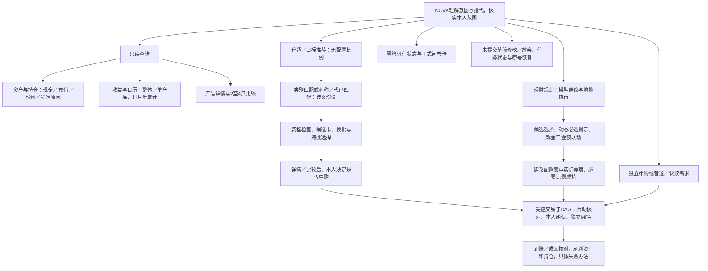
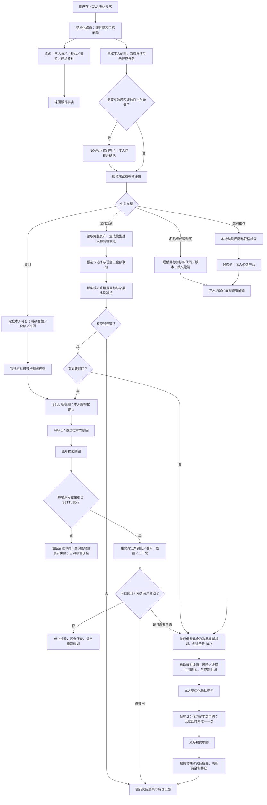

# 理财接入 NOVA：首期逻辑与 DAG

2026-10-23 当前交互更新：产品资料及赎回不再作为独立常驻功能区；详情／比较是选品的可选查看子步骤，持仓→赎回同一任务。整体收益只提供昨日／近一月／近一年／累计的金额、现金流校正收益率和单曲线，单产品收益／日历／自选日期退出正式界面。Agent收益先读取银行结果再短答；只读不弹风险问卷，金融终态／手动确认／独立MFA边界不变。[现行收益与入口契约](wealth_performance_overview.md)覆盖下文旧收益日历、单产品收益与独立入口的历史设计。

2026-10-21。本文保留已确认的业务设计；现已按此完成本地NOVA任务与可信卡片接线，接口与验证范围见[NOVA理财任务接口](../contracts/NOVA理财任务_API_v0.1.md)及[本轮验收](../validation/nova_wealth_agent_20261021.md)。参考现有 NOVA 路由／ReAct、即时转账子模型与固定 Skill、Task Manager、可信任务卡；理财继续复用现有财富动作、规划和银行执行接口。图表已本地完成；用户已确认先完成Agent，再做历史基础与批量增量，夏普仅记录，待Agent完成后再实施。

## 完整接入范围：主业务与配套功能

此前展示的图是交易主干，不是全部功能目录。类别推荐已经出现在原图，但“普通推荐”名称及推荐的换批、比较、修改等配套能力没有充分展开；实施范围按下表和完整功能地图，不得只实现规划→申赎的主干。

正式办理方式仍只有“理财规划”和“目标产品推荐”。本轮讨论的“普通推荐”按此前确认的第二条、不使用资产配置模型的目标推荐理解，不擅自恢复第三个办理方式或无条件默认推荐入口。用户只说“推荐一些产品”且类别或目标不明确时，先澄清类别／目标；不能擅自套用规划比例。

|功能|Agent与卡片应覆盖的具体行为|当前服务依据与边界|
|---|---|---|
|普通／目标产品推荐|类别、名称／代码匹配；明确用户指代；缺目标澄清；候选换批；跨批保留；查看与移除选择|recommend_products、portfolio/products；不调用整体配置，不按夏普排序；模拟银行理财／快赎与真实基金类别分别匹配|
|理财规划|生成模型建议；活钱／稳健／进取候选；稳健与进取分别换批；动态必选提示；三金额联动；建议表与执行金额；必要比例减持|plan_portfolio与当前增量规划；无自主稳健／进取比例调整，无活钱换批|
|产品资料与比较|直接按代码或选中对象看详情、切换观察窗口；比较2—4个产品；读缺失字段而不伪造收益|show_product_detail、compare_products；只读，不要求为了看资料先做风险问卷|
|账户与持仓|当前可用现金、冻结／应收、总资产、持仓／成本／最新净值、可赎份额与锁定原因、分页定位|assets、asset-summary、list_positions；服务端本人身份与范围核对，不把信用额度当可用现金|
|收益与日历|整体／单产品、日／月／年／累计；按日期切换；缺历史和未来日期如实说明|show_wealth_returns、returns；本人账务收益与基金行情指标分开|
|本人风险评估|查看有效状态；缺失／过期在NOVA正式问卷卡填写；提交、本人确认后接回原需求|questionnaire、assessments；Agent不能代答或代确认|
|直接申购|指定具体产品并填写金额，或推荐后多选逐项金额；全部已选统一核对；本人确认与一次独立MFA|target-purchases/prepare；直接申购不先生成整体配置|
|独立赎回|指定本人持仓；按份额／市值／比例；普通／合格快赎；多只分别填写再统一核对确认及一次独立MFA|redemptions/prepare；保留持有期、窗口、额度和可赎份额限制|
|规划先赎回后申购|比例赎回建议→第一份确认和MFA→实际到账核对→新BUY明细→第二份确认和MFA|portfolio prepare、continue-purchase；未知或部分失败阻断BUY，已到账留现金|
|修改、放弃与恢复|未提交草稿改目标／金额／选品；旧预览失效；可放弃未提交草稿或暂停后续步骤；读取已有任务及原号结果|既有方案版本与任务控制；已成交不能因改聊天草稿被撤销；未知成交不能换号补单|
|自动核对与反馈|准备时核对行情、风险、金额、现金；报价变化自动更新可更新预览，重新本人确认；说明不足差额与处理办法；结果后刷新|复用既有prepare、refresh-review、progress和银行回执；不能把模型回答当成交证据|

以下是功能地图；不是让模型直接调用所有工程端点。确认、MFA、提交和暂停等操作仍由受控卡片／执行器按本人动作完成。

风险评估是推荐／规划／交易按需经过的门槛，详细依赖见下面的交易DAG；账户查询和客观资料查看不因缺评估而一概阻断。历史等待订单、撤单页面、自主配置比例、第三种办理方式和夏普排序都不因“完整功能”而恢复。后台终态成交查询只用于实际状态和原号核对。

## 已确认的交互和边界

- 首期覆盖查询、目标推荐、理财规划、申购、赎回。正式风险评估缺失／过期时，在 NOVA 内展示正式问卷卡，由本人填写及确认；模型不能代答或推断风险等级。查询本人资产不因缺少申购评估而一概禁止。
- 用户明确指定产品名称、代码或当前候选序号时，模型理解意图，服务端核实准确代码、版本和上下文；同名、多匹配或序号范围不明时澄清。用户未指定产品时，展示候选卡，由本人勾选，Agent 不擅自挑选。换批保留本人选择，变化后重新验证。
- 目标推荐不调用资产配置模型。按类别先匹配类别／当前风险和申购资格；按名称／代码以身份匹配和用户意图为主。真实基金夏普策略本期不接入，模拟银行产品不与真实基金混排夏普。规划仍随机展示候选，稳健和进取独立换批，活钱不换批。
- 规划使用本人当前总资产（现金、持仓与应收按既有口径），不是仅以新增投入作为总资产。C为非信用可用现金，H为持仓市值；R+I=C，V=H+I，三个金额任选一项输入。Agent 明确表达的金额可填草稿，缺失不能代猜；本人可在卡内修改。
- 表格给模型建议比例和金额，下方列本次实际执行金额。旧持仓默认保持，只在超过模型硬限制时必要减持，受影响板块内按所有产品当前持仓市值比例赎回。持有期、可赎份额等不满足时给原因与处理办法，不改变其他产品的分摊替用户绕行。
- 申购与赎回分成两份独立确认和独立 MFA；同阶段多只产品可按原整份方案一次确认及一次 MFA。聊天里的“确认／执行”不能代替可信卡确认。验证码只在统一 SecondFactor 输入，不能进入模型上下文、历史或工具参数。
- 同一任务若需先赎回再申购，必须先核实全部赎回真实到账、费用与份额，再按最新事实生成全新 BUY 版本。第二阶段不继承任何 SELL 确认或 MFA。赎回部分失败／未知时阻止后续申购；已成功到账资金留现金，不自动追加赎回或回购。

## 用户可见业务 DAG

这是单个有效版本的依赖 DAG。用户修改参数后产生新版本，原授权失效；不在图内添加绕回执行的循环。成交未知只按原操作号查询，不换号重下。

`BNEW` 含两种不同调用：目标购买调用 `/target-purchases/prepare`，规划调用当前 PortfolioPlan 的 prepare；目标购买绝不通过配置模型。规划 SELL 接续使用已实现的 `/plans/{id}/continue-purchase`，保留当前“失败留现金”的边界。银行前置校验失败不创建订单或占款，卡内说明减少金额、补资、等待持有期／有效净值或重新选品等具体办法。

## 接入现有转账 Agent 架构的实施顺序

1. NOVA 路由 Schema 增加 wealth 域。新增固定理财 Skill 与专用理财子模型：读取原文、脱敏历史、当前卡片选择、可信业务结果及未终结理财任务，输出结构化查询／推荐／规划／申赎草稿。复用统一 DeepSeek 适配，不新增模型供应商。工具参数禁止 user_id、任意 URL、确认、验证码和直接银行执行接口。
2. 增加受控理财工具与任务桥接，服务端注入本人身份、context 与版本。复用现有 `/wealth/actions`、候选会话和交易准备服务；任务桥接只持有现有财富任务／方案引用，不另起一套账本或授权状态。聊天会话版本、候选版本、PortfolioPlan和执行计划版本分别保存。
3. NOVA 渲染正式问卷卡、候选／预算卡、模型建议与实际差额卡、可信交易确认和统一 MFA 卡。复用既有组件和接口，使页面工作台与 Agent 共用权限、数据和执行状态。不能仅回复一个跳转链接就宣称聊天内接入完成。
4. 接上阶段依赖和恢复：单独赎回／单独申购／必要赎回后申购；明确的两个独立操作也各自独立 MFA。参数修改、风险评估更新、账户范围变化清除未提交旧预览，已提交交易按原号恢复。
5. 验收：未评估→问卷→候选；名称／代码歧义；跨批选择与预算；超硬限比例减持及不可赎；两阶段两次MFA；费用和现金变化；未知／部分结果；暂停／接管；跨用户；重复消息幂等；NOVA会话刷新后读取实际任务状态。真实 DeepSeek 联调只验证草稿与只读问答，不替本人执行金融操作。

## 暂缓项

最新用户范围：先完成单个理财任务的按步展卡、完整明确输入自动进入核对、普通修正与需确认回退、依赖输入重置及成交／到账屏障。一句话多个理财操作的串行执行和跨场景自主排序均暂缓，后续再讨论，不属于当前实施。以后如接入，应先告知顺序，用户可改序，不额外强制用户确认顺序；各业务本人确认／MFA边界仍独立保留。

夏普排序、日更任务和展示区间在 Agent 首期完成后再实现。产品详情本地历史基础、批量增量同步也尚未接生产，需依据同日评估选择时机；不会为了接 Agent 等待全池缓存工程。自动刷新仍按之前确认的独立方案，在交易状态回执及卡内继续使用服务端自动核对；不新增全局“禁止行情接口”检查。
