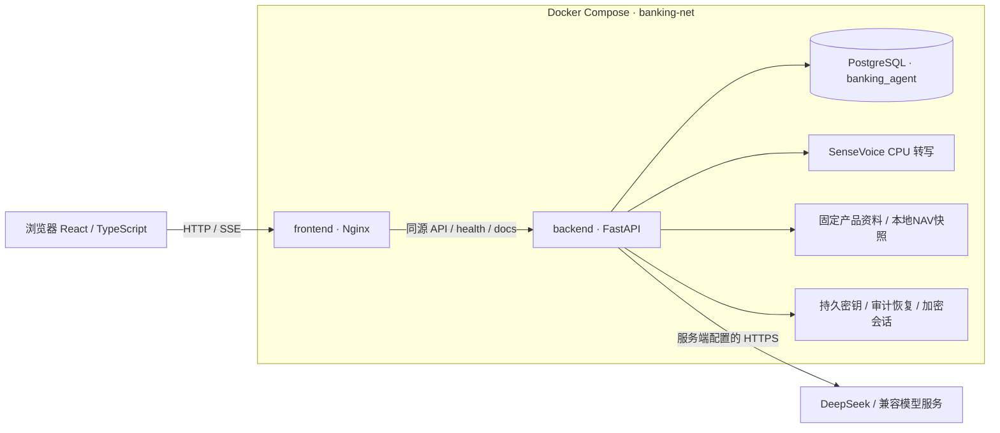
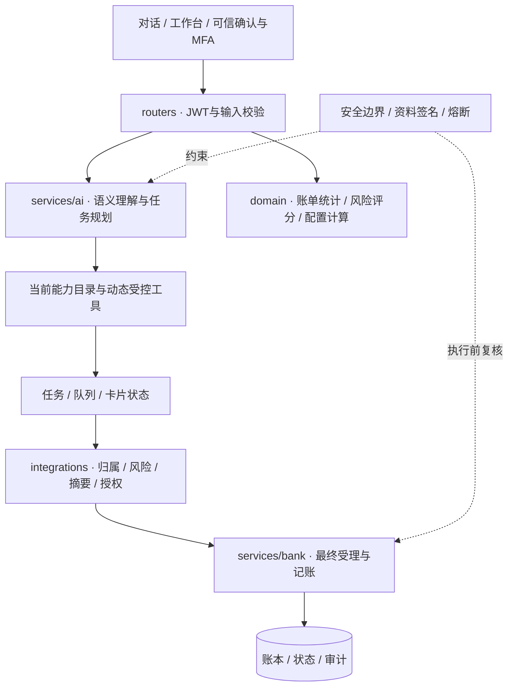
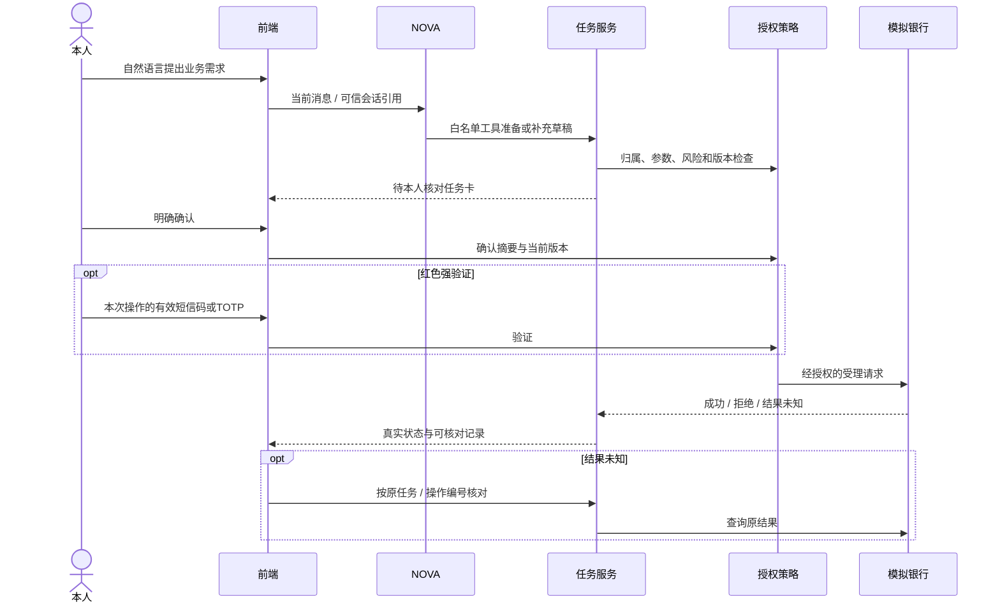

# NOVA · AI Banking Agent 技术文档

版本日期：2026-10-30。本文说明NOVA银行AI智能体的系统架构、核心算法与安全设计。评估对象为比赛模拟环境，验证记录按其执行日期、源码范围及测试环境列示。权限分级和已知风险见[安全自评报告](安全自评报告.md)，部署与操作步骤见[部署说明](docs/setup/deployment.md)和[测试用例](docs/testing/test_cases.md)。

## 1. 设计目标与实现范围

系统将自然语言理解、任务规划和可信界面办理组合为统一银行Web工作台。覆盖转账、账单、理财、卡片、订阅、日历和模拟商户等现有功能；银行账本、交易与短信均为比赛模拟。SenseVoice提供本地语音转文字，识别结果由本人检查后发送。系统以浏览器为交互入口，通过独立的任务确认与交易授权环节控制业务执行。

设计重点是缩短业务表达与办理路径，同时保持身份核验、风险分级、本人授权和结果追溯。模型负责理解需求与规划任务，确定性业务服务负责统计、约束计算及模拟记账。

## 2. 系统架构

### 2.1 部署架构



正式体验地址默认 `http://localhost:3000/`。后端、数据库和语音的端口绑定以Compose为准，现有主机端口暴露风险见自评报告。启动器复用本机覆盖配置，安装匹配资料、增量升级并等待健康，源码修改需要重建镜像。详见 [部署说明](docs/setup/deployment.md)。

### 2.2 应用分层与信任边界



| 模块 | 当前职责 |
|---|---|
| `frontend/src/components/NovaChat.tsx`、`Nova*Card.tsx` | 提问、流式状态、任务展示、本人确认；不在浏览器保存服务商API Key |
| `NovaTaskPresentation.tsx` | 共用卡片、工作台映射、人工接管及原输入保留 |
| `services/ai/nova_runtime.py`、`nova.py` | 依赖判断、能力选择、工具计划、已有业务子流程及结果组织 |
| `services/ai/task_graph.py`、`execution_queue.py` | 可视化目标图与持久执行队列；展示目标依赖，依据持久任务事实推进执行 |
| `services/bank/`、`services/orchestration/` | 银行事实、任务状态、定时推进、资金与业务记账 |
| `integrations/`、`security/` | 交易授权、可信身份、验证码、签名、边界检测与熔断 |
| `domain/` | 可独立测试的统计、适当性、配置和金额算法 |

界面为左侧统一导航、可展开的NOVA对话与业务工作台；操作卡可在聊天和人工工作台之间映射。登录球体使用同一持久画布，成功后约0.5秒移动，再约0.5秒淡入页面，其间禁用交互。

### 2.3 一次受控写操作



授权服务校验可信界面的本人确认、参数摘要、版本和验证码。明确拒绝与结果未知分别处理：前者显示拒绝原因，后者按原操作编号核对银行状态。

## 3. 意图理解、任务规划与答案生成

### 3.1 结构化语义与工具计划

主语义流程读取当前消息、可续接任务和脱敏上下文，输出严格Pydantic结构。当前能力目录见 [capability_catalog.py](backend/app/services/ai/capability_catalog.py)，统一阶段流程见 [nova_runtime.py](backend/app/services/ai/nova_runtime.py)。服务端验证字段原文引用、候选对象、归属、版本和业务限制；业务权限由认证会话与授权策略确定。历史辅助规则的覆盖核查见安全自评报告R-12。

单目标进入相应受控工具／子流程；多目标形成有依赖的计划，并通过现有执行队列推进。每轮工具集合、最大计划长度、阶段循环及超时均有限制，不同阶段分别配置执行预算。工具失败、重复无进展或达到预算时应停止或等待本人补充。

任务图只读展示目标关系、准备、等待确认、失败与完成状态。查询、任务准备、本人授权和银行成交分别记录状态；业务完成判定结合具体步骤与银行结果。

### 3.2 业务事实输出与知识解释是两条路径

- **业务结果路径**：通过工具事实、证据标识、服务端核验与结果组织输出。`grounding.py`保留证据指纹及受控证据选择／布局；运行流程结合各业务后处理生成最终回复。执行结果以银行状态和审计为准。
- **理财知识解释路径**：`planning_knowledge.py`向DeepSeek发送完整本地知识库、当前问题、阶段、最近对话及授权本地事实。模型生成正文与逐段证据引用；服务端核查引用确实存在，显示模型生成的解释。该路径仅依据知识库与已授权本地事实回答，未配置搜索或业务执行工具。
- **表达规则**：首次概述简短；追问只展开对应内容；确认启动后承接当前卡片；未覆盖如实说明。服务端进行引用存在性校验，解释与来源之间的语义一致性属于后续评估重点，见安全自评报告R-15。

识别具体类别／名称购买需求优先进入目标推荐，缺少具体产品或金额时，先按对应功能澄清或补充；只有确有投资操作意图且现有具体功能无法承接时才邀请进入规划。按钮／自然语言明确要求或确认后才启动规划，问答与启动确认均不构成申购授权。

## 4. 核心业务算法与一致性

### 4.1 转账与授权

实现主要位于 `integrations/authorization.py`、`services/orchestration/task_service.py` 和银行转账服务。金额使用整数分；累计风险计算包括当日已完成转出及应用侧未决占用，默认黄色上限100000分。确认与执行前重新核验累计风险，升级红色时需补强验证，避免拆分并发小额绕过。

参数摘要、计划／状态版本、一次性授权、风险占用及事务性outbox共同约束派发；银行以原操作编号核对，不以重复创建新交易恢复未知结果。改变收款对象、金额或其他绑定参数后旧确认不可复用。定时转账按本人指定时点单次执行。

### 4.2 账单、订阅与预测

账单分类、汇总、退款／互转口径、变化归因、预算和异常由银行服务的确定性逻辑计算；模型理解查询参数、组织解释或准备本人确认卡，不自行替账本算出未经核对的结果。代码见 `services/bank/bill_*.py`。

异常检测输出规则信号及相关流水依据，供用户核对。样本不足、无历史、估值缺失或范围不一致时显示未知或受限。订阅分析围绕已有订阅及扣费关联，现金流情景依据可用数据计算。统计细则见 `docs/contracts/` 及相应实现。

### 4.3 本人风险评估

[wealth_risk.py](backend/app/domain/wealth_risk.py)使用本人9题、每题0至3的模拟量表，总分映射五档，并由本金损失理解、风险理解及经验等设保守上限；还检查成年完全民事能力和关键矛盾。结果需本人确认且有效才参与资格判定。该量表用于模拟业务中的风险分级，专业效度尚待验证。

### 4.4 三板块配置与持仓投影

| 方法 | 输入与实现 | 输出边界 |
|---|---|---|
| 三板块约束二次优化 | 有效风险等级、本人偏好、共同资产分母、当前结构与可行约束；`wealth_portfolio_allocation.py` | 配置目标和允许调整范围，不是收益预测 |
| 持仓约束权重投影 | 所选产品、当前持仓、可持有／可新增条件；`wealth_portfolio_projection.py` | 板块内可行权重及整数分金额，不是完整多期交易优化 |
| 增量资金与交易差额 | 目标持仓、已有持仓及可支付资金；`wealth_incremental_planning.py` | 目标资产金额与本次买入不同；赎回未到账不当作可支付现金 |

整体目标的基本形式为：

```text
minimize  ||x - b||² + η ||x - h||²    subject to x ∈ P
```

x为三板块目标比例，b为项目政策／偏好参考结构，h为已有结构，P包含合计、非负、活钱、进取及产品可行条件。当前代码常量ETA为0.25、DELTA为0.01；缺少完整分类估值时，当前结构项停用，实际权重由分支条件确定。整体解使用低维约束几何／活跃集计算并验证；板块内使用有上界单纯形投影与整数分分配。界面接受约束内整数调整，并对调整组合整体复核合计、板块及产品可行条件。

心理账户是资金组织与沟通参考；Das、马科维茨等研究提供分账户后仍考虑整体的思路；Boyd与Vandenberghe提供凸优化数学方法，Boyd等的交易研究提供持仓、现金和变化表达。项目结合现有数据与业务约束选取相应方法进行工程实现。Thaler（1999）、Das等（2010，DOI:10.1017/S0022109010000141）、Boyd与Vandenberghe（2004）、Boyd等（2017，DOI:10.1561/2400000023）的采用范围见 [本地知识说明](backend/app/knowledge/wealth_planning.md)。

理查德·塞勒因行为经济学贡献获得2017年诺贝尔经济学奖，心理账户是其研究贡献之一；哈里·马科维茨为1990年诺贝尔经济学奖共同得主。本项目的整体协调思路参考Das、马科维茨等人2010年的合作研究。

选择这些方法是为了利用当前可获得的本人资产与偏好数据，将风险资格、资金用途、现有结构及产品条件纳入统一计算。模型以政策／偏好参考结构及已有结构为优化依据，未将预期收益或收益协方差作为优化输入。实现特点在于把可解释配置、持仓投影、适当性校验、可调整方案和交易确认流程连成可操作链路。

### 4.5 产品、行情与模拟交易

类别／名称／代码候选使用共享检索及资格核验；名称片段不自动选择产品。正式目录固定为806只普通真实基金加19个模拟银行定义，产品可售、风险、净值、窗口和额度仍需核验。候选结果按当前资格与数据状态筛选，必要数据缺失时返回对应原因。

新申赎使用最近已公布有效NAV，并绑定产品／披露版本、当前方案与授权摘要，核对本人评估、金额、可用资金和规则后由本人确认及MFA。模拟即时成交成功不可撤；历史在途／恢复事实与新政策按对应版本处理。行情更新估值，不重写已成交现金、份额及历史成本。目标推荐逐只填金额，不经过整体配置模型。

## 5. 安全设计

### 5.1 问题与原则

本项目关注错误理解、无依据结果、越权指令、未授权执行、重复提交和事后不可核对。原则是服务端控制权限、事实驱动状态、关键环节本人确认、高风险强验证及可追溯记录。参考2026年6月18日 [指导意见官方来源](https://www.nfra.gov.cn/cn/view/pages/ItemDetail.html?docId=1261784&generaltype=1&itemId=4216)（金发〔2026〕8号）中的风险分级、人工监督与安全治理方向。

### 5.2 纵深防御


- **权限与身份**：工具上下文身份来自认证会话，参数不能替换用户；查询和写入均核验归属。绿色／黄色／红色按具体业务策略执行，强验证不能越过产品风险和资金限制。
- **输入与供应链**：工具、页面及检索内容是数据而非新系统指令。资料HMAC签名、Skill发布清单、严格JSON及输出体积限制等见 `security/agent_guard.py`、`knowledge_integrity.py` 和 `release_integrity.py`。签名校验覆盖批准后资料的完整性，原始来源质量与模型供应链另行评估。
- **秘密与模型出口**：拒绝公开默认／短JWT密钥，缺省私有持久密钥；模型密钥仅后端配置。请求地址、重定向及来源白名单约束见统一LLM服务，外部模型通过受控接口参与理解与生成，业务执行由本地服务受理。
- **审计与熔断**：关键业务变更、授权与执行按现有审计规则记录；安全锁在最终受理处复核。普通查询、拒绝、未知结果和实际记账分开；前端操作记录提供业务追溯所需信息，模型原始输入输出按各自访问范围管理。
- **人工干预**：暂停、回退、取消和接管以任务真实状态及允许动作为准，不能回滚已成交事实。用户可通过正常业务记录核对执行事实。
- **沙箱边界**：Agent通过受限工具和服务逻辑隔离执行任务，未开放任意生成代码执行入口。容器最小权限、资源限制及监控的完整加固仍待实施，通用代码沙箱属于当前有限覆盖项。

模拟短信、网络暴露、浏览器令牌、数据库秘密、第三方模型及资料、管理员权限和验证缺口等剩余风险见[安全自评报告](安全自评报告.md)。

## 6. 验证结果与适用范围

| 验证项 | 已有记录 | 覆盖范围 |
|---|---|---|
| 前端逻辑与生产构建 | 2026-10-30前端128项通过，生产构建通过 | 状态、提示及相关前端逻辑 |
| 隔离浏览器验证 | 跨场景示例发送、错误提示、原请求编号保持及登录球体过渡用例 | 使用拦截API，检查界面行为和请求组织 |
| 算法与业务测试 | 约束满足、数值对照、金额及模拟交易一致性相关用例和历史记录 | 具体断言、环境和执行记录见[开发者测试索引](docs/testing/automated_tests.md) |
| 真实模型验证 | 既有理财知识问答专项记录 | 适用于对应阶段与测试问题；最终场景操作测试尚待执行 |

当前验证覆盖工程约束、数值一致性和模拟业务流程，尚未开展真实市场收益与风险效果评价。全量后端、安全及PostgreSQL并发回归需结合各自环境和执行记录评估。

当前产品范围为Web端模拟银行与受控工具调用。完整周期转账、全自动订阅发现、外部提醒推送、生日全自动采购及通用生成代码沙箱尚未实现。

部署复现见[部署说明](docs/setup/deployment.md)，逐场景输入、操作与预期见[测试用例](docs/testing/test_cases.md)。
