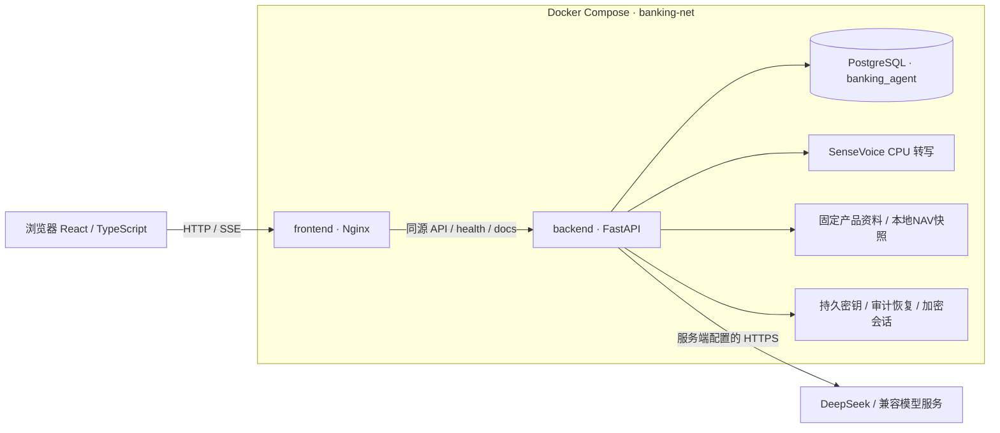
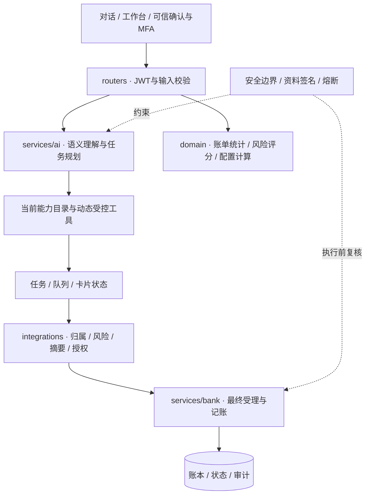

# NOVA · AI Banking Agent 技术文档

版本日期：2026-10-31。本文说明NOVA银行AI智能体的系统架构、核心算法、安全设计和验证结果。系统采用Web工作台与模拟银行服务，贯通自然语言表达、任务办理、本人授权和结果追溯。权限分级及风险处置见[安全自评报告](安全自评报告.md)，部署与操作见[部署说明](docs/setup/deployment.md)和[测试用例](docs/testing/test_cases.md)。

## 1. 设计目标与业务能力

系统将自然语言理解、任务规划和可信界面办理组合为统一银行Web工作台，覆盖转账、账单、理财、卡片、订阅、日历和模拟商户，采用比赛模拟账本、交易与短信通道。SenseVoice提供本地语音转文字，识别结果由本人检查后发送。系统以浏览器为交互入口，通过任务确认与交易授权控制业务执行。

设计重点是缩短业务表达与办理路径，同时保持身份核验、风险分级、本人授权和结果追溯。模型负责理解需求与规划任务，确定性业务服务负责统计、约束计算及模拟记账。

## 2. 系统架构

### 2.1 部署架构



默认体验地址为 `http://localhost:3000/`，前端通过Nginx同源代理访问后端，Compose统一配置后端、数据库和语音服务的端口及网络。启动器复用本机覆盖配置，安装匹配资料、执行增量升级并检查服务健康；源码更新通过镜像重建加载。部署步骤见 [部署说明](docs/setup/deployment.md)。

### 2.2 应用分层与信任边界



| 模块 | 当前职责 |
|---|---|
| `frontend/src/components/NovaChat.tsx`、`Nova*Card.tsx` | 提问、流式状态、任务展示和本人确认；服务商API Key由后端统一配置 |
| `NovaTaskPresentation.tsx` | 共用卡片、工作台映射、人工接管及原输入保留 |
| `services/ai/nova_runtime.py`、`nova.py` | 依赖判断、能力选择、工具计划、已有业务子流程及结果组织 |
| `services/ai/task_graph.py`、`execution_queue.py` | 可视化目标图与持久执行队列；展示目标依赖，依据持久任务事实推进执行 |
| `services/bank/`、`services/orchestration/` | 银行事实、任务状态、定时推进、资金与业务记账 |
| `integrations/`、`security/` | 交易授权、可信身份、验证码、签名、边界检测与熔断 |
| `domain/` | 统计、适当性、配置和金额算法，以及对应的独立测试 |

界面为左侧统一导航、可展开的NOVA对话与业务工作台；操作卡可在聊天和人工工作台之间映射。登录球体使用同一持久画布，成功后约0.5秒移动，再约0.5秒淡入页面，其间禁用交互。

### 2.3 一次受控写操作


授权服务校验本人确认、参数摘要、版本和验证码。银行返回成功、拒绝或结果待核对状态；拒绝时展示具体原因，响应中断或状态待核对时沿用原操作编号查询银行结果。

## 3. 意图理解、任务规划与答案生成

### 3.1 结构化语义与工具计划

语义流程读取当前消息、可续接任务和脱敏上下文，输出严格Pydantic结构。能力目录由 [capability_catalog.py](backend/app/services/ai/capability_catalog.py)提供，统一阶段流程由 [nova_runtime.py](backend/app/services/ai/nova_runtime.py)执行。服务端核验字段原文引用、候选对象、归属、版本和业务规则；认证会话及授权策略决定业务权限。

单目标进入对应受控工具／子流程，多目标形成依赖计划并通过执行队列推进。服务端配置每轮工具集合、计划长度、循环次数和超时预算；工具失败、重复调用无进展或达到预算时，停止本轮执行或转入用户补充状态。

任务图展示目标关系和准备、等待确认、失败、完成状态。查询、任务准备、本人授权和银行成交分别记录，业务步骤与银行结果共同决定完成状态。

### 3.2 业务事实输出与知识解释

- **业务结果路径**：通过工具事实、证据标识和服务端核验组织输出。`grounding.py`保留证据指纹并控制证据选择与布局，各业务后处理生成最终回复，银行状态和审计记录提供执行依据。
- **理财知识解释路径**：`planning_knowledge.py`向DeepSeek提供本地知识库、当前问题、办理阶段、最近对话和授权本地事实。模型生成正文与逐段证据引用，服务端核对引用原文后展示解释。知识来源与本人业务事实共同构成回答依据。
- **表达规则**：首次回答简明概述，追问展开对应内容，启动确认衔接当前卡片。服务端核验逐段引用，资料检索结果和原文支持内容决定解释段落的展示；质量管理见安全自评报告R-15。

具体类别或名称购买需求进入目标推荐，产品和金额通过对应任务卡补充。系统根据投资意图和具体功能匹配结果提供规划邀请，由本人通过按钮或明确自然语言确认启动。申购继续经过独立的交易确认和MFA流程。

规划解释采用 `backend/app/knowledge/wealth_planning.md` 作为本地知识来源，文件SHA256随诊断记录保存，用于追踪解释所依据的资料版本。数据库知识采用独立的签名检索流程，两类资料分别管理，发布维护见安全自评报告R-17。

## 4. 核心业务算法与一致性

### 4.1 转账与授权

实现主要位于 `integrations/authorization.py`、`services/orchestration/task_service.py` 和银行转账服务。金额使用整数分；累计风险计算包括当日已完成转出及应用侧未决占用，默认黄色上限100000分。确认与执行前重新核验累计风险，升级红色时需补强验证，避免拆分并发小额绕过。

参数摘要、计划／状态版本、一次性授权、风险占用及事务性outbox共同约束派发。结果待核对时沿用原操作编号查询银行，收款对象、金额或其他绑定参数变化后重新确认。定时转账按本人指定时点单次执行。

### 4.2 账单、订阅与预测

银行服务以确定性逻辑计算账单分类、汇总、退款／互转口径、变化归因、预算和异常，模型负责理解查询参数、组织解释和准备本人确认卡。统计事实由账本及银行服务提供，实现见 `services/bank/bill_*.py`。

异常检测输出规则信号及关联流水，支持本人逐项核对；数据充分性、历史样本、估值完整性和统计范围决定相应状态提示。订阅分析关联已有订阅与扣费记录，现金流情景根据可用资金、计划及历史数据计算。统计细则见 `docs/contracts/` 及对应实现。

### 4.3 本人风险评估

[wealth_risk.py](backend/app/domain/wealth_risk.py)采用9题、每题0至3分的模拟量表，将总分映射为五档风险等级。本金损失理解、风险理解及投资经验进一步确定等级上限，同时核验成年完全民事能力和关键答案矛盾。本人确认后的有效评估结果参与产品适当性与交易资格判定。

### 4.4 三板块配置与持仓投影

| 方法 | 输入与实现 | 输出结果 |
|---|---|---|
| 三板块约束二次优化 | 有效风险等级、本人偏好、共同资产分母、当前结构与可行约束；`wealth_portfolio_allocation.py` | 活钱、稳健、进取三板块配置目标及可调整范围 |
| 持仓约束权重投影 | 所选产品、当前持仓、可持有／可新增条件；`wealth_portfolio_projection.py` | 满足持仓与产品约束的板块内权重及整数分金额 |
| 增量资金与交易差额 | 目标持仓、已有持仓及可支付资金；`wealth_incremental_planning.py` | 分别计算目标持仓、本次增量买入、交易差额与到账可用现金 |

整体目标的基本形式为：

```text
minimize  ||x - b||² + η ||x - h||²    subject to x ∈ P
```

x为三板块目标比例，b为项目政策／偏好参考结构，h为已有结构，P包含合计、非负、活钱、进取及产品可行条件。当前代码常量ETA为0.25、DELTA为0.01；分类估值完整性决定当前结构项的启用状态，分支规则确定实际权重。整体解使用低维约束几何／活跃集计算并验证；板块内使用有上界单纯形投影与整数分分配。界面接受约束内整数调整，并对调整组合整体复核合计、板块及产品可行条件。

心理账户用于组织资金用途与用户沟通；Das、马科维茨等人的研究提供分账户与整体资产协调思路；Boyd与Vandenberghe的凸优化方法用于约束求解，Boyd等人的交易研究提供持仓、现金和变化的表达方式。项目将这些方法与个人数据及业务约束结合，实现整体配置、持仓投影和增量资金计算。理论与方法来源包括Thaler（1999）、Das等（2010，DOI:10.1017/S0022109010000141）、Boyd与Vandenberghe（2004）、Boyd等（2017，DOI:10.1561/2400000023），具体对应关系见 [本地知识说明](backend/app/knowledge/wealth_planning.md)。

理查德·塞勒因行为经济学贡献获得2017年诺贝尔经济学奖，心理账户是其研究贡献之一；哈里·马科维茨为1990年诺贝尔经济学奖共同得主。本项目的整体协调思路参考Das、马科维茨等人2010年的合作研究。

配置模型将风险资格、资金用途、资产结构及产品条件纳入统一计算，优化输入由政策／偏好参考结构、已有持仓结构和业务可行约束构成。整体配置、持仓投影、适当性校验、方案调整和交易确认共同形成可解释、可操作的办理链路。

### 4.5 产品、行情与模拟交易

类别、名称和代码通过共享检索形成产品候选，由本人核对并选择具体产品。正式目录固定为806只普通真实基金加19个模拟银行定义；服务端逐项核验可售状态、风险、净值、交易窗口及额度，按资格和数据状态筛选候选，并展示对应处理原因。

新申赎使用最近已公布有效NAV，绑定产品／披露版本、当前方案与授权摘要，核对本人评估、金额、可用资金和规则后，由本人确认并完成MFA。模拟即时成交后保存最终成交事实，历史在途订单按对应政策版本处理。行情更新持仓估值，已成交现金、份额和历史成本保留原值；目标推荐逐只填报金额并进入交易确认流程。

## 5. 安全设计

### 5.1 安全目标与原则

系统围绕幻觉防护、异常熔断、安全锁定、提示词注入防范、资料投毒防范、防篡改和越权防范建立分层控制。模型承担理解与规划，服务端掌握身份、权限、金额、资格、授权和最终记账的判定权。关键操作由本人确认，高风险操作通过MFA，执行全过程保留可追溯记录。安全设计参考2026年6月18日 [指导意见官方来源](https://www.nfra.gov.cn/cn/view/pages/ItemDetail.html?docId=1261784&generaltype=1&itemId=4216)（金发〔2026〕8号）中的风险分级、人工监督与安全治理方向。

### 5.2 纵深防御


- **幻觉防护**：业务事实来自银行查询和受控工具，金额与对象绑定用户原文或可复核来源。服务端核验引用、候选、版本和任务状态，按成功、失败、待确认和结果待核对分别组织回复。理财知识解释使用本地资料及授权事实逐段校验引用。
- **越权防范**：工具上下文身份由认证会话注入，查询与写入核验本人归属；服务端按业务和阶段提供工具白名单。绿色查询、黄色本人确认、红色本人确认加MFA分级执行，产品资格、风险等级和资金条件独立复核。
- **异常熔断与安全锁定**：登录失败、交易验证失败、授权违规和会话注入分别计数、锁定与恢复。交易锁提升授权代次，银行最终受理时复核锁状态；工具调用受循环、次数、超时和重复无进展约束，异常触发本轮停止。
- **注入与资料保护**：用户、历史、页面、工具结果和外部资料按其数据来源管理，系统授权由服务端策略决定。输入规范化、角色隔离、资料HMAC、Skill发布清单、严格JSON和尺寸限制共同约束模型输入输出。
- **审计与人工干预**：关键变更、授权、执行和拒绝记录关联到本人、任务及操作编号。暂停、回退、取消和人工接管按持久任务状态执行，已成交事实完整保留；结果待核对时沿用原操作编号查询银行。
- **执行隔离**：Agent通过固定工具注册、受限服务接口和分离容器执行业务。业务工具负责参数与权限检查，银行服务承担最终受理，模型输出通过结构化接口进入执行链路。

控制实现、风险判定与处置措施见[安全自评报告](安全自评报告.md)。

### 5.3 输入、资料与发布完整性

统一LLM客户端在文本、结构化和原生工具请求前加入共享信任边界说明。原消息最多256条、序列化体积上限1MiB，普通及SSE响应累计上限512KiB，工具参数字符串上限64KiB。`strict_json`拦截重复键、NaN、Infinity及溢出非有限数；工具执行入口核验对象参数与业务Schema，超限或协议错误即停止处理。

| 环节 | 当前措施与实现 | 控制结果 |
|---|---|---|
| 当前消息与历史 | `nova.py`、`injection_detector.py`、`agent_guard.py`执行Unicode规范化和格式字符处理，检测覆盖规则、伪造角色及秘密外泄指令；历史保留user／assistant正文，剔除高权限角色和附带工具调用 | 明确注入在业务规划前被拦截，恶意历史以隔离提示替代，正常业务更正继续按语义处理 |
| 页面、引用与工具 | 任务处理前检查页面和已有引用；统一客户端扫描 `role=tool` 内容，业务入口核验工具白名单、参数依据和本人权限 | 页面与引用中的注入触发本轮停止，工具调用经服务端校验受理；阶段封装与原始参数解析按R-08、R-19统一治理 |
| 数据库知识 | `wealth_knowledge.py`、`knowledge_integrity.py`使用HMAC-SHA256绑定文档ID、完整正文及元数据，入库检查注入和128KiB载荷上限，检索复核签名、指纹、数据集及有效期 | 正文、哈希、来源或版本被改写时签名校验失败，异常资料退出检索候选 |
| 历史资料补签 | 对照重新构造的批准资料核验旧行；模拟资料依据发布文件及哈希清单重建，混合资料通过审核导入流程重建 | 内容一致的旧资料获得签名，篡改行保持隔离，轮换后的资料按可信来源恢复 |
| 业务Skill | `release_integrity.py`、`skill_registry.py`按名称白名单及SHA256发布清单校验当前10个Skill，覆盖定时任务和日历查询；加载与启动时核验文件 | 文件缺失、改写或符号链接触发拒绝；Skill变更经差异审查后显式更新清单 |

数据库外独立密钥承担资料签名，应用代码与发布清单构成Skill信任根。本地规划Markdown采用文件版本追踪和引用核验，资料发布分别管理。只读Skill核验命令为 `python -m backend.app.security.release_integrity`；资料补签和密钥维护见 [Agent安全维护说明](docs/agent_security.md)。

### 5.4 秘密、隐私与运行资源

- **密码与强验证**：密码采用16字节随机盐、260000次PBKDF2-SHA256及恒定时间摘要比较。短信码以挑战ID为上下文保存HMAC，绑定本人、用途和具体操作；默认有效300秒、重发间隔60秒、每用户每小时最多10次发送、每挑战最多5次错误。重发作废旧码，成功消费随事务提交；TOTP通过已用时间步记录限制重放。
- **密钥生命周期**：JWT配置执行公开占位符和32字节最小长度检查，缺省生成私有持久登录密钥；知识签名采用独立 `AGENT_KNOWLEDGE_SIGNING_KEY` 或文件密钥。`AGENT_SECURITY_DIR`管理密钥目录，Compose使用 `agent_security`持久卷。文件按0600创建，非Windows环境检查文件权限，读取核对文件类型并采用平台支持的禁止跟随链接选项；并发创建以完整写入后原子发布保证一致。多实例受控共享，轮换管理同时处理登录、历史解密、卡号推导、短信挑战和资料签名。
- **会话与模型出口**：银行侧按本人归属读取会话，标题和消息采用随机nonce的AES-GCM加密；会话读取及NOVA主入口对完整手机号、银行卡号和已识别验证码脱敏。`NOVA_CONVERSATION_KEY`支持独立配置，缺省使用登录密钥。模型地址由后端配置，远端使用HTTPS，本机回环支持HTTP；`LLM_ALLOWED_ORIGINS`提供可选的精确来源控制，客户端关闭自动重定向和隐式环境代理。业务上下文按模块职责发送，服务商配置及字段管理纳入发布审核。
- **语音入口**：银行语音代理先认证后读取音频，校验格式和4MiB上传上限；每用户同时一个请求、每进程最多两个，识别服务串行处理0.2至45秒音频。音频及转写正文采用内存处理，代理使用独立请求向ASR发送音频，返回校验后且长度上限2000字符的文本。本人检查并手动发送文字后进入Agent。ASR采用固定审核源码及权重提交，关闭远程模型代码加载和运行时自动更新。
- **审计与诊断**：操作审计按字段白名单记录业务事实，查询及游标绑定本人和筛选条件，关键变更与审计同事务提交。普通访问恢复记录用于补录观察事件。NOVA诊断按需开启，脱敏后的请求、模型输入输出和工具过程按本人目录加密保存；目录0700、文件按0600创建，请求号格式校验，查看与下载执行登录验证并返回 `no-store`、`nosniff`。诊断配额与保留策略按R-18管理。

模型供应链按服务商配置、来源版本、依赖清单和发布制品分层管理。ASR固定源码、权重及依赖版本；后端范围版本依赖的目标平台锁定、漏洞扫描和制品审核列入R-16处置计划。

## 6. 验证结果

| 验证项 | 已有记录 | 验证内容 |
|---|---|---|
| 前端逻辑与生产构建 | 2026-10-30前端128项通过，生产构建通过 | 状态、提示及相关前端逻辑 |
| 隔离浏览器验证 | 跨场景示例发送、错误提示、原请求编号保持及登录球体过渡用例 | 使用拦截API，检查界面行为和请求组织 |
| 算法与业务测试 | 约束满足、数值对照、金额及模拟交易一致性相关用例和历史记录 | 具体断言、环境和执行记录见[开发者测试索引](docs/testing/automated_tests.md) |
| 真实模型验证 | 理财知识问答专项记录 | 对应阶段、测试问题及生成解释的来源核验 |
| 安全边界及隐私专项复核 | 2026-10-31现有4个测试文件共87项通过，当前10个Skill发布校验通过 | 覆盖输入／协议、资料与Skill篡改、语音代理和调试记录隔离；测试文件和执行记录见[安全自评报告](安全自评报告.md)第5节 |

验证按工程约束、数值一致性、模拟业务流程和安全专项组织；全量后端及PostgreSQL并发回归使用各自测试环境和版本记录管理。

当前产品为Web端模拟银行，采用受控工具调用、可信任务卡、本人授权和银行最终受理的业务执行方式。

部署复现见[部署说明](docs/setup/deployment.md)，逐场景输入、操作与预期见[测试用例](docs/testing/test_cases.md)。
