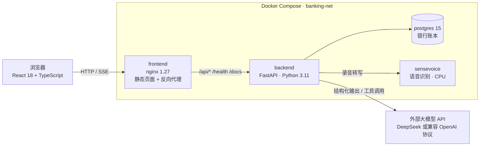
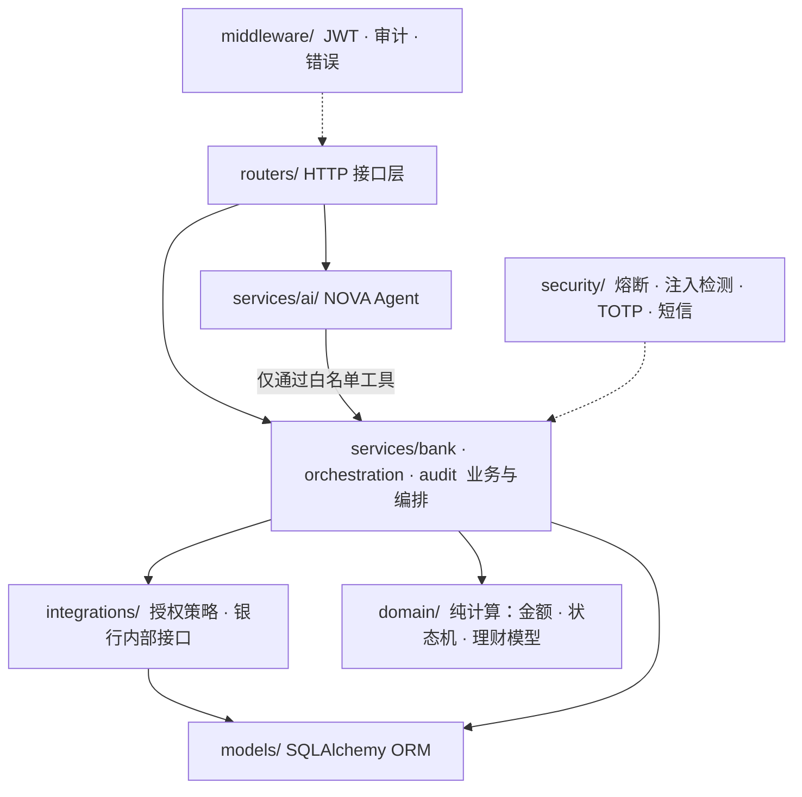
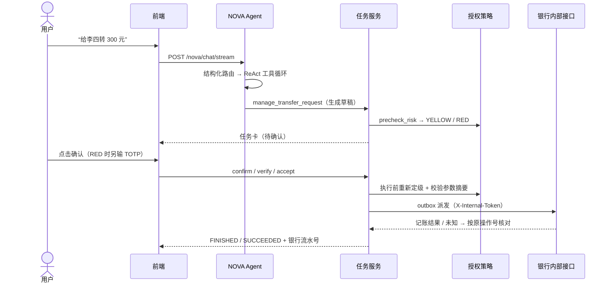
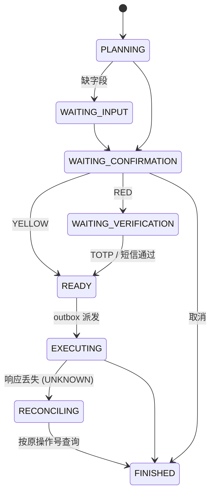
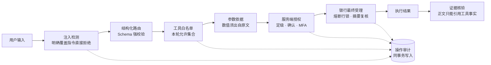

# AI Banking Agent 技术文档

代码基线：`main` @ `12480f4`（2026-10-25）。本文的路径都相对于仓库根目录。风险清单见 [安全自评报告](安全自评报告.md)，各模块接口契约见 `docs/contracts/`。

## 1. 系统架构

### 1.1 部署架构



- 浏览器只访问 nginx 这一个入口，页面和 `/api/v1` 同源，不需要处理跨域。
- 后端启动时依次执行理财资料升级、`create_all` 增量建表、写入演示种子数据，并启动两个后台循环：定时转账调度（2 秒一轮）和理财任务推进（3 秒一轮）。
- 大模型的配置统一放在 `.env`（`LLM_MODE / LLM_MODEL / LLM_BASE_URL`），未配置时走离线规则模式。

### 1.2 后端分层



| 层 | 目录 | 职责 |
| --- | --- | --- |
| 接口 | `backend/app/routers/` | 每个业务一组 API，Pydantic 模型校验入参（`schemas/`） |
| Agent | `backend/app/services/ai/` | 路由、ReAct 工具循环、多目标串行队列、证据核验、转账/收款/理财对话子流程 |
| 业务 | `backend/app/services/bank/` | 账户、转账、账单分析、卡片、订阅、收款申请、商户退款 |
| 编排 | `backend/app/services/orchestration/` | 转账任务状态机、outbox 派发、定时调度、理财计划与任务 worker |
| 授权 | `backend/app/integrations/` | 转账、卡片、理财三套权限策略；银行内部接口客户端 |
| 领域 | `backend/app/domain/` | 不访问数据库的纯函数：金额换算、状态枚举、风险评估、组合优化 |
| 横切 | `middleware/`、`security/`、`services/audit/` | 鉴权、熔断、审计 |

### 1.3 前端结构

`frontend/src/App.tsx` 布局：左侧是 NOVA 对话侧栏（`components/NovaChat.tsx`），右侧是业务工作台（资产、账单、卡片、日历、理财、第三方商店）。NOVA 返回的任务以卡片形式渲染（`Nova*Card.tsx`），用户的确认和 MFA 都在卡片上完成。接口封装在 `services/*.ts`：普通请求走 axios（`baseURL: '/api/v1'`），聊天走 SSE 流（`/api/v1/nova/chat/stream`）。

### 1.4 一次聊天转账的完整链路



## 2. 核心算法

### 2.1 NOVA Agent 编排（`backend/app/services/ai/nova.py`）

**① 结构化路由。** `route_request` 调用一次模型，输出 `RequestRoute`（Pydantic，`extra="forbid"`）：

- `mode`：`direct_react`（单目标）或 `goal_plan`（多目标或存在依赖）；
- `domains`：涉及的业务域；
- `task_action`：本轮相对当前操作是 continue、read、switch 还是 unclear。

校验器强制约束：单目标路由不能带计划、依赖或多个业务域；多目标必须附带 2–8 个目标组成的无环计划，每个目标的 `source_text` 必须逐字引用用户原文。

**② ReAct 工具循环。** 模型在受限工具集合内循环规划和调用，有以下终止与熔断条件：

| 限制 | 值 | 触发结果 |
| --- | --- | --- |
| 单轮最大步数 / 工具调用数 | `MAX_STEPS = 10` / `MAX_TOOL_CALLS = 10` | `AGENT_TOOL_LIMIT` |
| 同名同参数（规范化 JSON）重复调用 | 第 3 次 | `AGENT_NO_PROGRESS` |
| 连续工具失败 | 3 次 | `AGENT_CONSECUTIVE_FAILURES` |
| 调用本轮未授权的工具 | — | 返回 `TOOL_NOT_ALLOWED`，并写入审计 |

单目标直达转账时，服务端会**丢弃外层模型填写的工具参数**，改由转账子模型重新读取服务端保存的用户原文来抽取收款人和金额。这样可以避免外层模型在推理中改动数字。

**③ 多目标串行队列（`execution_queue.py`）。** 计划持久化在 `nova_executions` 表中，内容 AES-GCM 加密，且一次只激活一个目标。前一个目标要等到**银行侧的终态事实**出现才算完成，模型声称完成或浏览器事件都不算，之后才解锁下一个目标。系统不提供重新排序的 API。

**④ 证据核验（grounding-v1，`grounding.py`）。** 本轮每个工具结果在服务端计算 SHA-256 指纹，生成证据编号。模型最终只输出 `{"evidence_ids": [...], "clarification": ...}`，正文由服务端按证据渲染。出现未知编号或附带自由正文时，回退为服务端摘要。流式输出要等核验结束后才发送正文。

### 2.2 转账风险定级与任务状态机

**定级（`integrations/authorization.py: precheck_risk`）**

```
cumulative = 银行当日已完成转出 + Σ 本应用未决占用 RiskReservation(HELD)
level      = YELLOW  if cumulative + amount ≤ 100_000 分（1000 元）
             RED     otherwise
```

把未决占用计入累计额，可以防止同时发起多笔小额转账、每笔都低于阈值的拆分绕过。确认之后、扣款之前还会**重新定级一次**，结果升级为 RED 时退回去要求强验证。

**状态机（`domain/state_machine.py`）**



保证一致性的几个机制：

- **参数摘要**：`param_digest = SHA-256(付款账户, 收款账户, 金额分, 币种, 备注, 收款手机号)`。授权与摘要、计划版本绑定，修改参数就生成新版本，旧授权失效。
- **乐观并发**：每次状态变更都校验 `state_version`，客户端 `request_id` 用于去重。
- **事务性 outbox**：受理时，授权消费、风险占用和 outbox 记录在同一事务中写入。之后由派发器携带 `control_epoch` 提交给银行；执行权版本不一致时拒绝派发。
- **未知结果核对**：网络或响应丢失时，状态记为 `UNKNOWN`，不会重新扣款，而是用同一个 `operation_id` 去查询银行事实（`reconcile_task`）。

### 2.3 账单分析（`backend/app/services/bank/bill_*.py`）

账单分析全部是**确定性计算**。模型只负责从问句里抽取查询参数（抽出的字段必须逐字出现在原文中），不参与任何算术。

| 算法 | 规则 |
| --- | --- |
| 分类优先级 | 订阅类交易 → 本人单笔修正 → 本人商户规则 → 原始类目（不在 7 类内归为 other）。原始分类不改写，退款跟随原单类别（`bill_classification.py`） |
| 分类建议 | 同一商户已有 ≥2 条本人修正、且其中 ≥80% 属同一类时建议该类；否则用商户名关键词匹配，恰好命中一类才建议。建议不会自动生效 |
| 周期识别 | 按「账户 + 商户 + 收支方向」分组，依次尝试月 / 周 / 季 / 年四种频率。要求 ≥3 笔样本、金额极差 ≤ 中位数的 20%。周频要求相邻间隔 6–8 天；月、季、年要求月序号严格连续，且日期差 ≤3 天或全部为月末。超过一个周期没有新观测时标为 `STALE`（`bill_recurring.py: detect_pattern`） |
| 现金流预测 | 1–62 天，默认 30 天。起点为储蓄账户余额减去理财占款，叠加订阅计划、已授权定时转账、已启用的周期流、手动计划。可变消费基线取最近 3 个完整自然月、剔除固定支出后的日均值，样本不足（<5 笔或 <2 个月）的类别不估计（`bill_cashflow.py`） |
| 情景区间 | 不宣称统计置信区间。高、低两条余额线分别取 3 个月中最高、最低的月日均消费 |
| 预测校准 | 至少 3 个（最多 5 个）已结束、互不重叠的基准快照，系数 = 实际 / 预测，限制在 [0.5, 1.5]，只作用于可变消费（`bill_forecasts.py`） |
| 预算状态 | disabled → exceeded → warning（达到预警比例）→ projected_exceeded（已花 + 预测剩余天数消费 > 预算）→ ok |
| 异常检测 | 单笔大额：≥1000 元，或 ≥100 元且达到上期中位数的 3 倍（上期 ≥5 笔）；疑似重复：同账户、同商户、同金额，300 秒内出现两笔；类别激增：比上期多 ≥200 元且增幅 ≥50%。核对结果绑定证据指纹，证据一变就重新进入 pending |
| 变化归因 | 按「类别 + 商户」把环比变化拆成次数效应和单笔金额效应（`bill_explanation.py`） |

### 2.4 理财：风险评估与组合配置

**风险评估（`domain/wealth_risk.py`）**

```
total = Σ 9 题得分（每题 0–3）                     ∈ [0, 27]
level = 1 + #{edge ∈ (6, 12, 18, 24) : total ≥ edge}   ∈ [1, 5]
level = min(level, loss+2, understanding+2, experience+2)
purchase_allowed = loss > 0 ∧ payment > 0 ∧ liabilities > 0
```

- 封顶规则保证：收入或资产再多，也不能单独抬高风险等级。
- 「不能接受本金损失」同时选了「增长目的」，判为矛盾，要求本人澄清。
- 评估有效期 365 天，重评每日最多 2 次、滚动 12 个月最多 8 次。财务画像变化后评估立即失效。

**产品池与资格。** 原 900 只基金中剔除 94 只无数值夏普的，剩 806 只（债券 242、混合 501、权益 63），清单在 `config/wealth/compact_pool.json`。逐份额资格判定（`wealth_portfolio_eligibility.py: qualify_purchase`）要求：版本和披露可证、银行当前事实一致（渠道、开放日、净值未过期、无未来数据）、起购额和限额已知，且产品风险 ≤ 用户等级（否则为 `RISK_EXCEEDS_CAPACITY`）。

**板块配置模型（`domain/wealth_portfolio_allocation.py`，`portfolio-geometric-projection-v1`）**

决策变量为现金管理、稳健、增长三个板块的占比 `x = (c, s, g)`，`c + s + g = 1`：

```
minimize   ‖x − b‖² + η‖x − h‖²         η = 0.25（持仓估值不完整时 η = 0）
b = [0.2, 0.8(1−p), 0.8p]                p = 用户增长偏好，缺省取 p0；R1 时 b = [1, 0, 0]
h = 当前持仓结构（各板块市值 / 总资产）

s.t.  c ≥ cmin
      g ≤ pmax · (1 − c)
      无可买产品的板块 ≤ 原持仓占比
      （给出明确偏好时）g = p · (1 − c)
```

| 等级 | cmin | p0 | pmax |
| --- | --- | --- | --- |
| R1 | 1（全现金） | — | — |
| R2 | 0.1 | 0 | 0.25 |
| R3 | 0.1 | 0.25 | 0.50 |
| R4 | 0.1 | 0.50 | 0.75 |
| R5 | 0.1 | 0.75 | 1.00 |

- **求解**：目标函数严格凸，约束是二维多边形。依次枚举无约束中心、各边上的度量投影、各顶点，取损失最小且通过最优性校验的点，因此得到的是精确解，不依赖网格搜索。
- **η 的含义**：在目标配置和现有持仓之间做折中，减少不必要的调仓。
- **整数化**：在最优解附近 ±3 分范围内搜索整数分金额，用 `Fraction` 精确校验约束。
- **可调范围**：「损失 ≤ 最优损失 + δ（δ = 0.01）」的点构成一个椭圆，与约束多边形求交，得到每个板块的可调区间。前端滑块固定现金占比，调节「增长占非现金部分的比例」，每一档都要通过区间、整数分和起购额校验。
- **板块内分到产品**（`wealth_portfolio_projection.py`）：目标 `y = (u + 0.25h) / 1.25`，其中 u 为等权、h 为现有持仓。先投影到带上界的单纯形（二分法，100 次迭代），再用最大余数法分配到分。不可增购的份额只能维持或减少。

配置模型**刻意不使用**预期收益、波动率或协方差，避免把历史业绩当成承诺。单产品的历史指标只做展示（`wealth_analytics.py`）：区间收益、年化收益（样本跨度 ≥365 天才计算）、最大回撤、年化波动率（日收益标准差 × √252，≥20 个样本），样本不足时给出原因，不补零。`wealth_portfolio_dpp.py`（DPP/MMR 多样性选择）只是历史研究代码，生产环境强制使用按代码 / 类别排序的选择器。

**下单。** 每批 1–160 笔。申购需通过适当性、起购额 / 限额、可用资金、保留一个月支出四项校验；赎回按 FIFO 只取已过持有期、未被占用的批次，赎回费按持有天数分档。每笔订单都需要本人确认和 TOTP/短信强验证，授权 10 分钟过期，并与当前计划版本绑定。

## 3. 安全设计

整体设计原则：**模型负责理解和规划，服务端负责事实和授权**。权限、金额、执行结果都不依赖模型输出，所以模型理解错误或被注入时，影响范围最多到"生成一张错误的待确认卡"。

### 3.1 纵深防御



### 3.2 对照五项安全要求

| 要求 | 设计 | 实现位置 |
| --- | --- | --- |
| **权限分级** | GREEN 查询直接执行；YELLOW 本人确认；RED 确认 + TOTP/短信。转账按当日累计金额（含未决占用）定级，卡片按固定动作表定级（未知动作按 RED），理财设置适当性与支付能力硬门槛 | `integrations/authorization.py`、`card_authorization.py`、`wealth_authorization.py` |
| **幻觉防护** | 证据编号绑定工具结果的 SHA-256；模型不能写自由事实正文；数值参数必须能在原文中找到出处（`PARAMETER_NOT_GROUNDED`）；未核验的正文不推流 | `services/ai/grounding.py`、`parameter_grounding.py` |
| **注入防御** | 以结构性防御为主：授权与模型无关、工具白名单、页面与历史内容只作为数据传入、名称和备注转义引用。启发式检测为辅：NFKC 规范化后匹配明确的覆盖指令 | `services/ai/nova.py`、`security/injection_detector.py` |
| **操作审计** | 覆盖 API、AI 决策（路由、工具、阻断、证据）、授权判定、业务表变更、后台任务。关键变更与审计写入同一事务，审计失败则业务回滚；数据库不可写时，访问日志进入本地追加文件，之后补录；字段白名单脱敏；本人可查询和导出 | `services/audit/`、`middleware/audit.py` |
| **异常熔断** | 登录 10 分钟错 5 次锁 15 分钟；强验证连续错 5 次或累计错 10 次，锁交易 15 分钟；授权违规 5 分钟 3 次锁 30 分钟；注入 5 分钟 3 次暂停会话；Agent 工具循环无进展时熔断。锁定会提升 `generation`，让旧授权失效 | `security/circuit_breaker.py` |
| **沙箱环境** | Agent 没有代码执行能力（没有 exec / eval / subprocess 路径），能力只限于服务端注册的工具，数据访问受本人身份约束；各服务在独立容器中，通过内部网络通信 | `services/ai/nova_tools.py`、`docker-compose.yml` |

### 3.3 关键安全不变量

1. 资金和卡片变更必须经过「本人确认」，RED 级还需要「强验证」。NOVA 代码中不存在调用确认、验证、执行接口的路径。
2. 授权一次性使用，并与参数摘要和计划版本绑定。参数一变，就必须重新确认。
3. 执行前重新定级，银行受理时持安全行锁复核熔断状态，不依赖前端或 Agent 自觉遵守。
4. 结果未知时只按原操作号核对，不重复提交。
5. 用户可见的业务数字全部来自服务端计算或工具返回值。
6. 敏感数据处理：密码使用 PBKDF2-SHA256 加盐哈希（26 万次迭代）；短信码只存 HMAC；对话内容 AES-GCM 加密（`NOVA_CONVERSATION_KEY`）；审计不记录密码、Token、验证码、完整手机号或卡号。

已知不足与整改计划见 [安全自评报告 · 已知风险清单](安全自评报告.md#4-已知风险清单)。其中优先级最高的两项是：短信开发收件箱默认开启，以及 PostgreSQL 对局域网开放。

## 4. 运行与验证

```bash
# 启动（Windows 也可以双击 start_bank.cmd）
docker compose up -d --build --wait --wait-timeout 300
# 当前 compose 中前端映射为 3101：http://127.0.0.1:3101/   健康检查 /health   API 文档 /docs

# 安全专项测试
python -m pytest tests/security -q
python -m pytest tests/integration/test_operation_audit.py -q
```

各模块的验收记录见 `docs/validation/`。全量离线测试存在既有失败（旧理财夹具没有适配新规则），PostgreSQL 并发用例需要单独配置 `BANK_TEST_DATABASE_URL` 才能运行。
